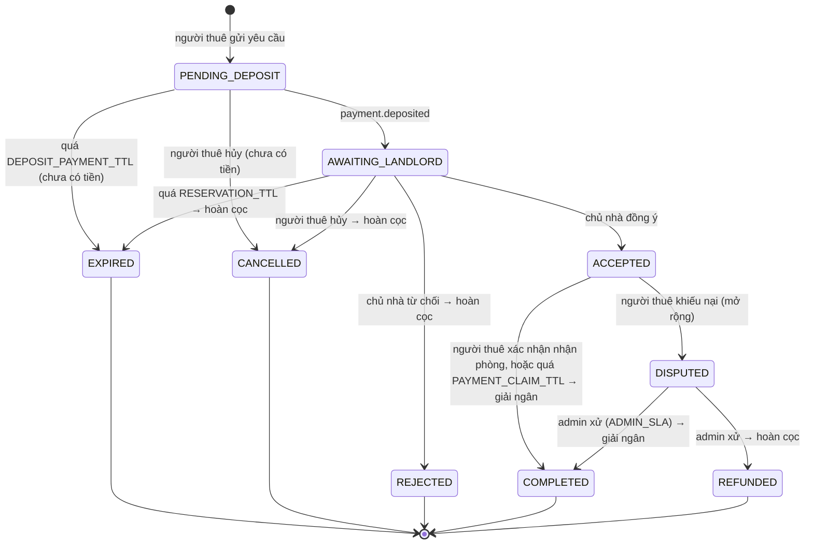

# Ranh giới service

- Trạng thái: Chấp nhận
- Ngày: 2026-11-06
- Phạm vi: đồ án, team 3 người

Tài liệu này là nguồn sự thật về **service nào sở hữu dữ liệu nào** và **service nói chuyện với nhau
thế nào**. Muốn đổi API hoặc event của service khác: sửa tài liệu này và `contracts/` trước, code sau.

## 1. Phạm vi

| Service      | Cổng | Trạng thái          | Người phụ trách | Ghi chú                                               |
| ------------ | ---- | ------------------- | --------------- | ----------------------------------------------------- |
| api-gateway  | 8080 | làm                 | A               | Mỏng: định tuyến, xác thực JWT, sinh `X-Request-ID`   |
| identity     | 3001 | làm                 | A               | Postgres `identity_db`                                |
| notification | 3005 | làm                 | A               | Postgres `notification_db` (bỏ Mongo, xem ADR-008)    |
| listing      | 3002 | làm                 | B               | Postgres `listing_db` + PostGIS, ảnh trên S3          |
| rental       | 3003 | làm                 | C               | Postgres `rental_db`                                  |
| payment      | 3004 | làm                 | C               | Postgres `payment_db`                                 |
| assistant    | 3006 | nếu còn thời gian   | B               | Không DB riêng, chỉ gọi API tìm kiếm của listing      |
| mobility     | —    | **gộp vào listing** | —               | Tính khoảng cách bằng PostGIS ngay trong `listing_db` |
| maintenance  | —    | **bỏ**              | —               | Ngoài luồng chính                                     |

Rental và payment **không gộp**: luồng đặt cọc giữa hai service là nơi thể hiện event, saga và bù trừ.
Một người (C) giữ cả hai đầu để giảm phối hợp ở phần khó nhất.

## 2. Ai sở hữu dữ liệu nào

Mỗi dữ liệu chỉ có **một** service được ghi. Service khác chỉ giữ **ID** (không foreign key) và
**snapshot** (bản sao tại một thời điểm, cũ một chút là chấp nhận được).

| Service      | Sở hữu (chỉ nó được ghi)                                                 | Chỉ giữ ID / snapshot                                                                       |
| ------------ | ------------------------------------------------------------------------ | ------------------------------------------------------------------------------------------- |
| identity     | User, mật khẩu (hash), vai trò `TENANT/LANDLORD/ADMIN`, refresh token    | —                                                                                           |
| listing      | Tin đăng, giá, giá cọc, tiện ích, ảnh, tọa độ, cờ hiển thị `isAvailable` | `landlordId`, tên chủ nhà (snapshot)                                                        |
| rental       | Yêu cầu giữ chỗ (reservation), trạng thái, mọi **hạn thời gian**         | `listingId`, `tenantId`, `landlordId`, `depositAmount` (snapshot), tiêu đề phòng (snapshot) |
| payment      | Ví escrow, giao dịch nạp cọc, hoàn tiền, giải ngân                       | `reservationId` (tham chiếu), `payerId`, `payeeId`                                          |
| notification | Lịch sử thông báo, template                                              | `userId`, email (snapshot từ event)                                                         |

Quy tắc rút ra:

- **"Phòng có đang bị giữ không?" do rental quyết.** Rental chặn đặt trùng bằng ràng buộc DB (mỗi
  `listingId` tối đa một reservation đang hoạt động). Cờ `isAvailable` của listing chỉ để hiển thị và
  lọc tìm kiếm, cập nhật theo event, có thể trễ vài giây.
- **Payment không biết phòng hay hợp đồng là gì.** Nó chỉ biết "giữ X đồng cho tham chiếu R, của người
  P, sẽ trả cho người Q hoặc hoàn lại P".
- **Đồng hồ do rental giữ.** Mọi hạn (chờ thanh toán, chờ chủ nhà, thời gian khiếu nại) do job của rental
  kiểm tra. Payment không tự hẹn giờ cho reservation, chỉ phản ứng theo event.

## 3. Luồng giữ chỗ và đặt cọc

**Quyết định: người thuê trả cọc trước, chủ nhà duyệt sau.**

- Chủ nhà chỉ thấy những yêu cầu nghiêm túc (đã có tiền trong escrow).
- Thể hiện được **bù trừ** (compensation) của saga: từ chối hoặc quá hạn thì hoàn tiền tự động.
- Phương án ngược lại (chủ nhà duyệt rồi mới trả) đơn giản hơn nhưng gần như không có bù trừ, nên mất
  phần đáng demo nhất.

| Hạn                           | Biến                          | Giá trị dev     | Ý nghĩa                                      |
| ----------------------------- | ----------------------------- | --------------- | -------------------------------------------- |
| Chờ thanh toán cọc            | `DEPOSIT_PAYMENT_TTL_SECONDS` | 900 (15 phút)   | **Biến mới, cần thêm vào `.env.example`**    |
| Chờ chủ nhà trả lời           | `RESERVATION_TTL_SECONDS`     | 86400 (24h)     | Đã có                                        |
| Thời gian khiếu nại sau duyệt | `PAYMENT_CLAIM_TTL_SECONDS`   | 259200 (3 ngày) | Đã có; hết hạn không khiếu nại thì giải ngân |
| Admin xử khiếu nại            | `ADMIN_SLA_SECONDS`           | 86400 (24h)     | Đã có; chỉ dùng nếu làm phần `DISPUTED`      |

Khi demo, đặt các TTL ngắn (ví dụ 60 giây) để cho hội đồng thấy hoàn tiền tự động.

## 4. Gọi đồng bộ (HTTP)

Chỉ dùng khi **cần câu trả lời ngay để quyết định**. Mọi API nội bộ có prefix `/internal`, gateway không expose.

| Gọi                   | Endpoint                         | Khi nào                        | Lấy gì                                                                    |
| --------------------- | -------------------------------- | ------------------------------ | ------------------------------------------------------------------------- |
| gateway → mọi service | `/api/v1/*`                      | Mọi request từ client          | —                                                                         |
| rental → listing      | `GET /internal/listings/:id`     | Lúc người thuê gửi yêu cầu     | Tin còn đăng không, `depositAmount`, `landlordId`, tiêu đề → lưu snapshot |
| payment → rental      | `GET /internal/reservations/:id` | Lúc người thuê bắt đầu trả cọc | `status = PENDING_DEPOSIT`, `depositAmount`, `tenantId`, `landlordId`     |

Nếu listing chết, người thuê không gửi được yêu cầu mới (trả 503 `UPSTREAM_UNAVAILABLE`). Mọi luồng khác
(duyệt, hoàn tiền, thông báo) vẫn chạy. Đây là cái giá chấp nhận được của một lời gọi đồng bộ.

## 5. Event (RabbitMQ, exchange `domain.events`)

Routing key `<miền>.<sự kiện>`. Mọi event có `eventId` (UUID, để consumer chống xử lý trùng),
`occurredAt` (ISO UTC), `correlationId`. Schema chi tiết đặt ở `contracts/events/` (chủ đề Giao tiếp).

| Event                 | Phát bởi | Payload chính                                                                              | Ai nghe → làm gì                                                                       |
| --------------------- | -------- | ------------------------------------------------------------------------------------------ | -------------------------------------------------------------------------------------- |
| `identity.registered` | identity | `userId`, `email`, `fullName`, `role`                                                      | notification → email chào mừng                                                         |
| `rental.requested`    | rental   | `reservationId`, `listingId`, `tenantId`, `landlordId`, `depositAmount`, `paymentDeadline` | listing → `isAvailable = false`; notification → nhắc người thuê thanh toán             |
| `payment.deposited`   | payment  | `reservationId`, `paymentId`, `amount`                                                     | rental → `AWAITING_LANDLORD`; notification → báo chủ nhà có yêu cầu                    |
| `rental.accepted`     | rental   | `reservationId`, `tenantId`, `landlordId`, `claimDeadline`                                 | notification → báo người thuê                                                          |
| `rental.rejected`     | rental   | `reservationId`, `listingId`, `tenantId`, `reason`                                         | payment → hoàn cọc; listing → `isAvailable = true`; notification                       |
| `rental.expired`      | rental   | `reservationId`, `listingId`, `tenantId`, `stage`                                          | payment → hoàn cọc **nếu đang giữ tiền**; listing → `isAvailable = true`; notification |
| `rental.cancelled`    | rental   | `reservationId`, `listingId`, `tenantId`                                                   | như `rental.expired`                                                                   |
| `rental.completed`    | rental   | `reservationId`, `listingId`, `landlordId`                                                 | payment → giải ngân cho chủ nhà; listing → đánh dấu đã cho thuê; notification          |
| `payment.refunded`    | payment  | `reservationId`, `paymentId`, `amount`, `payerId`                                          | notification                                                                           |
| `payment.released`    | payment  | `reservationId`, `paymentId`, `amount`, `payeeId`                                          | notification                                                                           |

Queue hiện có trong `infra/rabbitmq/definitions.json`: `listing.indexer`, `notification.events`,
`rental.payment-events`. Cần thêm `payment.rental-events` và `listing.rental-events` (làm ở chủ đề Giao tiếp).

## 6. Các ca khó (phải xử lý, không được bỏ qua)

1. **Tiền đến muộn.** Người thuê trả cọc lúc 15:01, reservation đã `EXPIRED` lúc 15:00. Rental nhận
   `payment.deposited` cho một reservation không còn `PENDING_DEPOSIT` → **không** chuyển trạng thái, mà
   phát lại `rental.expired`. Payment thấy mình đang giữ tiền của reservation đó → hoàn.
2. **Hai người giữ cùng một phòng.** Cả hai đều thấy `isAvailable = true` (listing chưa kịp cập nhật).
   Rental có unique index một phần trên `listingId` với các trạng thái đang hoạt động → người thứ hai nhận
   409 `RENTAL_LISTING_ALREADY_RESERVED`.
3. **Event bị giao hai lần** (RabbitMQ đảm bảo _ít nhất một lần_). Consumer lưu `eventId` đã xử lý; gặp
   lại thì bỏ qua. Payment không bao giờ hoàn hay giải ngân hai lần cho một reservation.
4. **Chủ nhà bấm "đồng ý" đúng lúc job hết hạn chạy.** Đổi trạng thái bằng câu lệnh có điều kiện
   (`UPDATE ... WHERE id = $1 AND status = 'AWAITING_LANDLORD'`); bên nào cập nhật được 0 dòng thì thua.

## 7. Không được làm

- Không JOIN, không foreign key, không đọc DB của service khác (user DB đã bị chặn ở Postgres).
- Không gọi HTTP dây chuyền A → B → C trong một request.
- Không để hai service cùng ghi một dữ liệu (ví dụ listing tự quyết phòng còn trống).
- Không đưa entity hay logic nghiệp vụ vào code dùng chung giữa các service.
