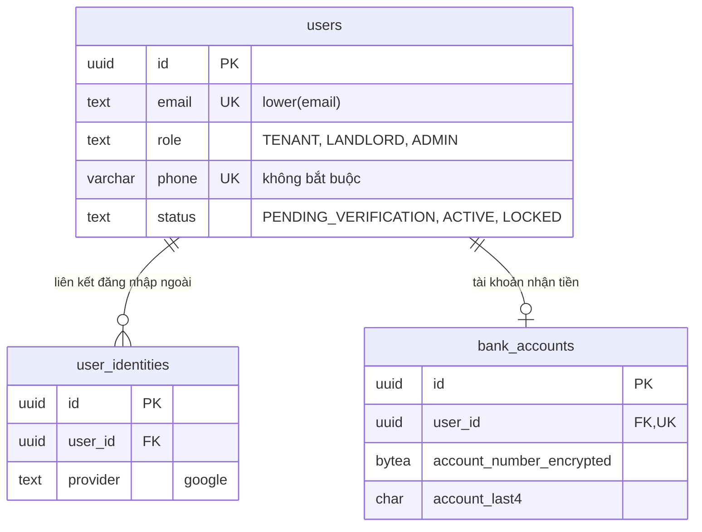
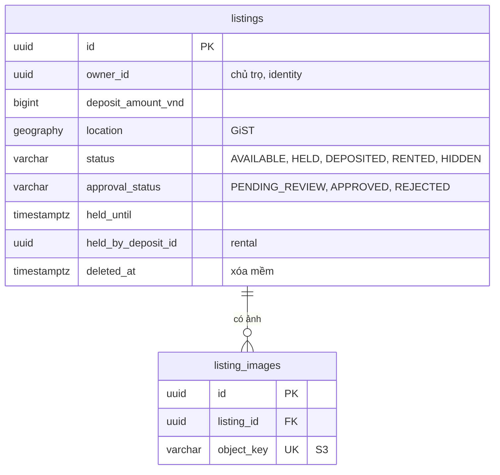
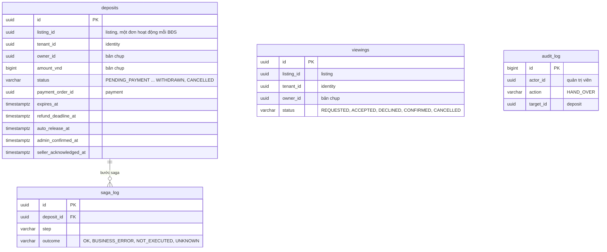
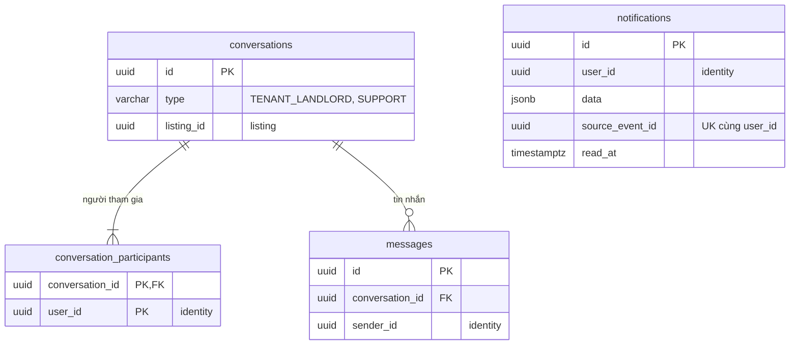

# Mô hình dữ liệu Real-estate

> Năm database, mỗi service một database (ADR-0002). File này là ERD tổng hợp. Cột đầy đủ, ràng buộc, index nằm ở DDL trong `API_Spec.md` của chức năng, ghi ở cột "DDL đầy đủ". Đọc khi: cần nhìn toàn cảnh dữ liệu, vẽ Hình 3.8 cho báo cáo, thêm bảng mới.

| | |
|---|---|
| **Chủ sở hữu / Cập nhật / Phiên bản** | hoang.lv — 2026-11-12 — v1.0 |
| **Nguồn** | DDL trong 10 file `design/*/*/API_Spec.md`; Báo cáo v2 Bảng 3.5, Hình 3.7–3.8 |

## 1. Quy ước

- Khóa ngoại chỉ trong cùng database. Cột `*_id` trỏ sang service khác là tham chiếu logic, không có khóa ngoại (`coding-convention.md §5`).
- Tiền `bigint` VND, thời gian `timestamptz` UTC, ID `uuid` sinh bằng `gen_random_uuid()`.
- Sơ đồ chỉ ghi khóa và cột quyết định nghiệp vụ. `PK` khóa chính, `FK` khóa ngoại, `UK` duy nhất.
- Service phát sự kiện có `outbox_events`; service nhận sự kiện có `processed_events` (`design/SHARED/RE.MESSAGING/API_Spec.md`).

## 2. Database và bảng

| Database | Bảng | DDL đầy đủ |
|---|---|---|
| `identity_db` | `users`, `user_identities`, `bank_accounts`; Redis: refresh token, OTP, token đặt lại mật khẩu | `design/IDENTITY/RE.IDENTITY/API_Spec.md` |
| `listing_db` | `listings`, `listing_images` | `design/LISTING/RE.LISTING/API_Spec.md` |
| `rental_db` | `deposits`, `saga_log` | `design/RENTAL/RE.DEPOSIT_SAGA/API_Spec.md` |
| | `audit_log` | `design/RENTAL/RE.DEPOSIT_LIFECYCLE/API_Spec.md` |
| | `viewings` | `design/RENTAL/RE.VIEWING/API_Spec.md` |
| `payment_db` | `payment_orders`, `payos_webhook_events`, `late_payments` | `design/PAYMENT/RE.PAYMENT/API_Spec.md` |
| | `admin_wallet`, `wallet_transactions`, `refund_requests`, `withdrawal_requests`, `transfer_receipts`, `audit_log` | `design/PAYMENT/RE.PAYOUT/API_Spec.md` |
| `notification_db` | `notifications` | `design/NOTIFICATION/RE.NOTIFICATION/API_Spec.md` |
| | `conversations`, `conversation_participants`, `messages` | `design/NOTIFICATION/RE.CHAT/API_Spec.md` |
| Dùng chung | `outbox_events`, `processed_events` | `design/SHARED/RE.MESSAGING/API_Spec.md` |

## 3. identity_db

Mỗi tài khoản một vai trò ở `users.role` (B9, 2026-11-12); không có `roles`, `user_roles` như Báo cáo Bảng 3.5.

## 4. listing_db

## 5. rental_db

DDL hiện tại không có khóa ngoại giữa `viewings` và `deposits`.

## 6. payment_db

```mermaid
erDiagram
    payment_orders ||--o{ late_payments : "tiền đến muộn"
    refund_requests }o--o| transfer_receipts : "chứng từ"
    withdrawal_requests }o--o| transfer_receipts : "chứng từ"
    payment_orders {
        uuid id PK
        uuid deposit_id UK "rental"
        bigint payos_order_code UK
        varchar payos_reference UK
        varchar status "PENDING, PAID, CANCELLED"
    }
    payos_webhook_events {
        uuid id PK
        varchar reference "UK khi PAID hoặc LATE"
        varchar result
        jsonb raw
    }
    late_payments {
        uuid id PK
        uuid order_id FK
        varchar payos_reference UK
    }
    admin_wallet {
        smallint id PK "một ví"
        bigint balance_vnd ">= 0"
    }
    wallet_transactions {
        uuid id PK
        varchar type "DEPOSIT_IN, LATE_PAYMENT_IN, WITHDRAW_OUT, REFUND_OUT"
        bigint amount_vnd
        varchar ref_type
        uuid ref_id "UK cùng ref_type"
    }
    refund_requests {
        uuid id PK
        uuid deposit_id "rental"
        varchar requester_type "TENANT, SYSTEM"
        varchar status "PENDING_ADMIN, COMPLETED, REJECTED, FAILED"
        uuid receipt_id
    }
    withdrawal_requests {
        uuid id PK
        uuid deposit_id "rental, một lệnh mở mỗi đơn"
        uuid owner_id "identity"
        varchar status "PENDING, COMPLETED, FAILED"
        uuid receipt_id
    }
    transfer_receipts {
        uuid id PK
        char sha256 UK
        varchar object_key "S3"
    }
    audit_log {
        bigserial id PK
        uuid actor_id
        varchar action
    }
```

`wallet_transactions` trỏ tới order, tiền đến muộn, lệnh rút hoặc yêu cầu hoàn qua cặp `ref_type`, `ref_id`; bất biến ví: `RE.PAYOUT/Processing_Flow.md §4`.

## 7. notification_db

## 8. Tham chiếu giữa các service

| Cột | Ở bảng | Trỏ tới | Giữ bản chụp |
|---|---|---|---|
| `owner_id`, `tenant_id`, `user_id`, `sender_id`, `actor_id` | nhiều bảng | `identity_db.users` | `owner_id` trong `deposits`, `viewings` |
| `listing_id` | `deposits`, `viewings`, `conversations` | `listing_db.listings` | `listing_title`, `amount_vnd` trong `deposits` |
| `held_by_deposit_id` | `listings` | `rental_db.deposits` | |
| `deposit_id` | `payment_orders`, `refund_requests`, `withdrawal_requests`, `wallet_transactions` | `rental_db.deposits` | `tenant_id`, `owner_id`, `listing_title` trong `payment_orders` |
| `payment_order_id` | `deposits` | `payment_db.payment_orders` | |
