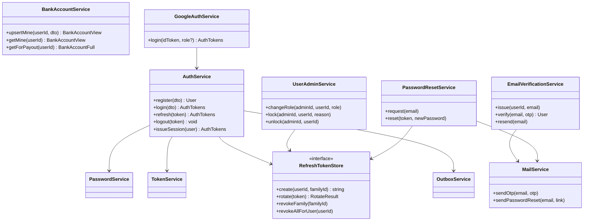

# RE.IDENTITY — Thiết kế thành phần

| | |
|---|---|
| **Service** | `services/identity/src/identity/` |
| **Quy ước** | `standards/coding-convention.md`, `standards/security-policy.md` |
| **Chủ sở hữu / Cập nhật / Phiên bản** | hoang.lv — 2026-11-18 — v2.0 |

## 1. Cấu trúc

Đã có (đánh dấu `+` là phần đề xuất thêm):

```text
src/identity/
├─ identity.module.ts
├─ controllers/
│  ├─ auth.controller.ts                 # register, login, refresh, logout, me, + verify-otp, resend-otp, forgot/reset-password, google
│  ├─ + profile.controller.ts            # PATCH /users/me
│  ├─ + bank-account.controller.ts       # /users/me/bank-account
│  ├─ + users.admin.controller.ts        # /admin/users
│  └─ + users.internal.controller.ts     # /internal/users/:id/bank-account
├─ services/
│  ├─ auth.service.ts                    # luồng; issueSession(user)
│  ├─ password.service.ts                # argon2id
│  ├─ token.service.ts                   # ký JWT RS256
│  ├─ + bank-account.service.ts          # mã hóa/giải mã, che số
│  ├─ + user-admin.service.ts            # danh sách, khóa/mở khóa + thu hồi phiên
│  ├─ + email-verification.service.ts    # sinh, kiểm OTP (Redis)
│  ├─ + password-reset.service.ts        # token đặt lại (Redis)
│  ├─ + google-auth.service.ts           # kiểm ID token, tìm/tạo/liên kết user
│  └─ + mail.service.ts                  # SMTP (nodemailer), mẫu email OTP, đặt lại
├─ stores/
│  ├─ refresh-token.store.ts             # interface
│  └─ redis-refresh-token.store.ts       # Lua script xoay vòng nguyên tử
├─ dto/ entities/ (user, user-identity, + bank-account) errors/ config/ seed/
```

## 2. Sơ đồ lớp



`revokeAllForUser(userId)` (chốt 2026-11-16): mỗi lần cấp họ token mới, `SADD identity:user-families:<userId> <familyId>` và gia hạn TTL 7 ngày; thu hồi = đọc set, đặt `identity:revoked:<familyId>` cho từng phần tử rồi xóa set. Gọi khi khóa tài khoản, đặt lại mật khẩu (Bảng 2.6). Bỏ đổi vai trò 2026-11-18.

## 3. Redis

```text
identity:rt:<sha256(token)>   hash {userId, familyId, used}   TTL 7 ngày
identity:revoked:<familyId>   "1"                             TTL 7 ngày
identity:user-families:<userId> set {familyId}                TTL 7 ngày (gia hạn khi thêm)
identity:otp:<userId>         hash {otpHash, attempts}        TTL OTP_TTL_SECONDS
identity:otp-cooldown:<userId> "1"                            TTL OTP_RESEND_COOLDOWN_SECONDS
identity:pwreset:<sha256(token)> userId                       TTL PASSWORD_RESET_TTL_SECONDS
```

OTP băm bằng SHA-256 kèm `userId` trước khi lưu; so sánh hằng thời gian.

## 4. Seed ADMIN

`pnpm seed:admin` với `SEED_ADMIN_EMAIL`, `SEED_ADMIN_PASSWORD` (≥ 12 ký tự, không ghi `.env`). Chạy lại an toàn; không nâng quyền người dùng thường.

## 5. Test bắt buộc

| # | Tình huống | Mong đợi | Trạng thái |
|---|---|---|---|
| 1 | Đăng ký email trùng khác hoa thường | `409 IDENTITY_EMAIL_TAKEN` (Báo cáo T01) | Có (`auth.infra-spec.ts`) |
| 2 | Đăng ký `role=ADMIN` | `400` | Kiểm lại |
| 3 | Hai đăng ký đồng thời cùng email | Một `201`, một `409` | Có |
| 4 | Sai mật khẩu, sai email | Cùng `401 IDENTITY_INVALID_CREDENTIALS` (Báo cáo T02) | Có |
| 5 | Dùng lại refresh token đã đổi | `401`, cả họ bị thu hồi (Báo cáo T03) | Có |
| 6 | Hai refresh đồng thời cùng token | Một thành công | Có |
| 7 | Đăng ký ghi outbox cùng transaction | Rollback thì không có sự kiện | Có |
| 8 | `identity.registered` đúng schema | `expectEventMatchesContract` | Kiểm lại |
| 9 | Khai tài khoản ngân hàng | Lưu mã hóa, response chỉ bốn số cuối | Mới |
| 10 | ~~Đổi vai trò~~ | Bỏ 2026-11-18 (không còn route đổi vai trò) | Bỏ |
| 11 | `/internal/users/:id/bank-account` chưa khai | `404 IDENTITY_BANK_ACCOUNT_NOT_FOUND` | Mới |
| 12 | Seed chạy hai lần | Không đổi gì | Có (`seed-admin.infra-spec.ts`) |
| 13 | Đăng ký mới | `status = PENDING_VERIFICATION`, Mailpit nhận một email OTP | Mới |
| 14 | Đăng nhập khi chưa xác minh / bị khóa (đúng mật khẩu) | `403 IDENTITY_EMAIL_NOT_VERIFIED` / `403 IDENTITY_ACCOUNT_LOCKED`; sai mật khẩu vẫn `401` | Mới |
| 15 | OTP đúng | `ACTIVE`, trả cặp token | Mới |
| 16 | OTP sai 5 lần | Lần 5 xóa mã; mã đúng sau đó vẫn `400` | Mới |
| 17 | Gửi lại OTP trong 60 giây | `429 IDENTITY_OTP_RESEND_TOO_SOON` | Mới |
| 18 | Quên mật khẩu email không tồn tại | `202`, không gửi email | Mới |
| 19 | Đặt lại mật khẩu, dùng lại token | Lần 1 `204` và refresh token cũ `401`; lần 2 `400` | Mới |
| 20 | Google, user mới thiếu `role` | `400 IDENTITY_ROLE_REQUIRED`; có `role` → tạo user `ACTIVE` + `identity.registered` | Mới |
| 21 | Google, email đã có tài khoản `PENDING_VERIFICATION` | Liên kết, `ACTIVE`, `password_hash = null` | Mới |
| 22 | Khóa tài khoản | Refresh token cũ `401`; đăng nhập `403`; gọi khóa lần hai `200` | Mới |
| 22a | Mở khóa tài khoản chưa xác minh | Về `PENDING_VERIFICATION`; đã xác minh thì về `ACTIVE` | Mới |
| 23 | `phone` trùng | `409 IDENTITY_PHONE_TAKEN` | Mới |

## 6. Đã chốt

Thu hồi mọi phiên của một người dùng: set họ token theo user (§2, §3), chốt 2026-11-16.
