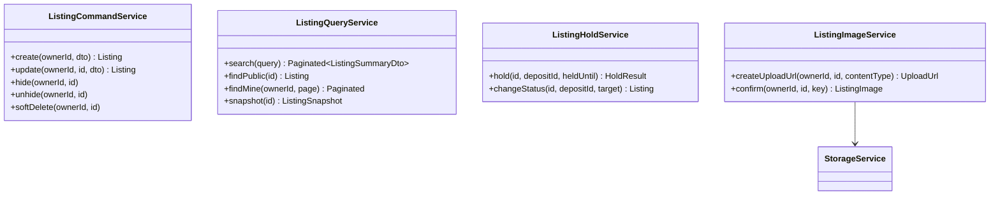

# RE.LISTING — Thiết kế thành phần

| | |
|---|---|
| **Service** | `services/listing/src/listing/` |
| **Quy ước** | `standards/coding-convention.md`, `standards/non-functional-standards.md` |
| **Chủ sở hữu / Cập nhật / Phiên bản** | hoang.lv — 2026-11-20 — v1.4 |

## 1. Cấu trúc

```text
src/listing/
├─ listing.module.ts
├─ controllers/
│  ├─ listings.controller.ts           # route 1–8, 11–12
│  ├─ listings.admin.controller.ts     # route 9–10
│  └─ listings.internal.controller.ts  # a, b, c (@Public, @ApiExcludeController)
├─ services/
│  ├─ listing-command.service.ts       # tạo, sửa, ẩn, xóa mềm; kiểm chủ sở hữu
│  ├─ listing-query.service.ts         # tìm kiếm PostGIS, chi tiết, của tôi (T2.2: findPublic, findMine; T2.3: search, snapshot)
│  ├─ listing-search.sql.ts            # hàm thuần: query route 11 → { countSql, dataSql, params } (T2.3)
│  ├─ listing-edit.rules.ts            # hàm thuần: sửa trường nào, ở trạng thái duyệt nào thì về PENDING_REVIEW (§1.1 API_Spec)
│  ├─ listing-review.service.ts        # duyệt, từ chối
│  ├─ listing-image.service.ts         # presign, HeadObject, lưu key
│  ├─ listing-hold.rules.ts            # hằng STATUS_TRANSITIONS (bảng §2.2 API_Spec) + hàm thuần chọn chuyển (T2.3)
│  └─ listing-hold.service.ts          # hold, changeStatus: UPDATE có điều kiện, 0 dòng thì đọc lại (T2.3)
├─ dto/ (search-listings.query, listing-summary.dto, hold, change-status, bản chụp nội bộ) entities/ (listing, listing-image) errors/listing.errors.ts
└─ seed/                               # 30 tin có tọa độ thật (Hà Nội), 3 chủ trọ (theo kế hoạch E3-7)
```

## 2. Sơ đồ lớp



`ListingHoldService.changeStatus` chứa bảng chuyển hợp lệ như một hằng số, mỗi chuyển là một `UPDATE ... WHERE status = <từ> AND held_by_deposit_id = $depositId`.

## 3. Test bắt buộc

| # | Tình huống | Mong đợi |
|---|---|---|
| 1 | Người không phải chủ sửa tin | `403 LISTING_NOT_OWNER` (Báo cáo T04) |
| 2 | Xóa tin `HELD` hoặc `DEPOSITED` | `409`, không xóa (Báo cáo T18) |
| 3 | Tạo tin | `PENDING_REVIEW`, không xuất hiện ở tìm kiếm |
| 4 | Tìm trong bán kính 2 km trên **fixture** của test (tin tọa độ thật ở Hà Nội có khoảng cách biết trước + ~5.000 tin ngẫu nhiên, đã `ANALYZE`); seed chạy lại `EXPLAIN` ở T2.4 | Đúng tập, đúng thứ tự `distance`, `distanceM` đúng; `EXPLAIN` dùng `ix_listings_location` (Báo cáo T05) |
| 5 | Giữ chỗ tin `AVAILABLE` | `HELD`, `held_until` đúng |
| 6 | Giữ chỗ tin `HELD` còn hạn hoặc `HIDDEN` | `409 LISTING_NOT_AVAILABLE` (Báo cáo T06) |
| 7 | 50 lời giữ chỗ đồng thời, Postgres thật | Đúng một `200` |
| 8 | Giữ chỗ lại cùng `depositId` | `200`, không đổi |
| 9 | Giữ chỗ tin `HELD` đã quá `held_until` | `200` cho đơn mới |
| 10 | Mỗi chuyển ở bảng §2.2, gọi hai lần (kể cả đích `AVAILABLE`, §2.2 idempotent) | Lần hai `200`, không đổi |
| 11 | Chuyển với `depositId` khác, dựng trên tin `HELD` và tin `DEPOSITED` thuộc đơn khác; cặp không có trong bảng | `409 LISTING_INVALID_STATUS` kèm `details { current, target }`; tin không đổi |
| 12 | Ảnh vượt kích thước | `400 LISTING_IMAGE_INVALID`, key không lưu, `deleteObject` được gọi |
| 13 | Xác nhận lại cùng `key` | `200` kèm ảnh đã có, không thêm dòng, không đổi `approval_status` |
| 14 | Sửa tin `REJECTED` (bất kỳ trường) hoặc thêm ảnh | `PENDING_REVIEW`, xóa `reject_reason` |
| 15 | Sửa tin `APPROVED`: `title` → `PENDING_REVIEW`; `priceVnd` → giữ `APPROVED` | Theo bảng §1.1 API_Spec |
| 16 | Hai lần xác nhận ảnh đồng thời khi còn một chỗ | Đúng một `201`, tin không vượt 10 ảnh |
| 17 | `deleteObject` lỗi khi ảnh không hợp lệ | Vẫn `400 LISTING_IMAGE_INVALID`, ghi log `warn` |
| 18 | Tìm kiếm: từng bộ lọc (giá, diện tích, quận, tiện ích, `available`), sắp xếp, phân trang | Đúng tập và thứ tự; không có tin `PENDING_REVIEW`, `REJECTED`, đã xóa, `HIDDEN`; `pageSize` > 50 → `400`; `coverImageUrl` đúng, `null` khi chưa có ảnh (nốt phần "tìm kiếm" của test 3) |
| 19 | Query sai: `lat` không có `lng`, `radiusKm` thiếu `lat/lng`, `radiusKm` ≤ 0 hoặc > 50, `sort=distance` thiếu `lat/lng`, `minPrice > maxPrice`, tiện ích lạ | `400 VALIDATION_FAILED`. Có `lat/lng` không `radiusKm` → không lọc bán kính, vẫn có `distanceM` |
| 20 | Bản chụp nội bộ (route a) | Trả cả tin `HIDDEN`, `PENDING_REVIEW`; tin đã xóa hoặc không có → `404`; response khớp `listing-internal.v1.yaml` |
| 21 | Mọi response của 3 API nội bộ (`200`, `400`, `404`, `409`) | Khớp ví dụ trong `listing-internal.v1.yaml` (`expectResponseMatchesOpenApi`) |

## 4. Đã chốt

Xem `API_Spec.md §7` (2026-11-16, 2026-11-19, 2026-11-20).
