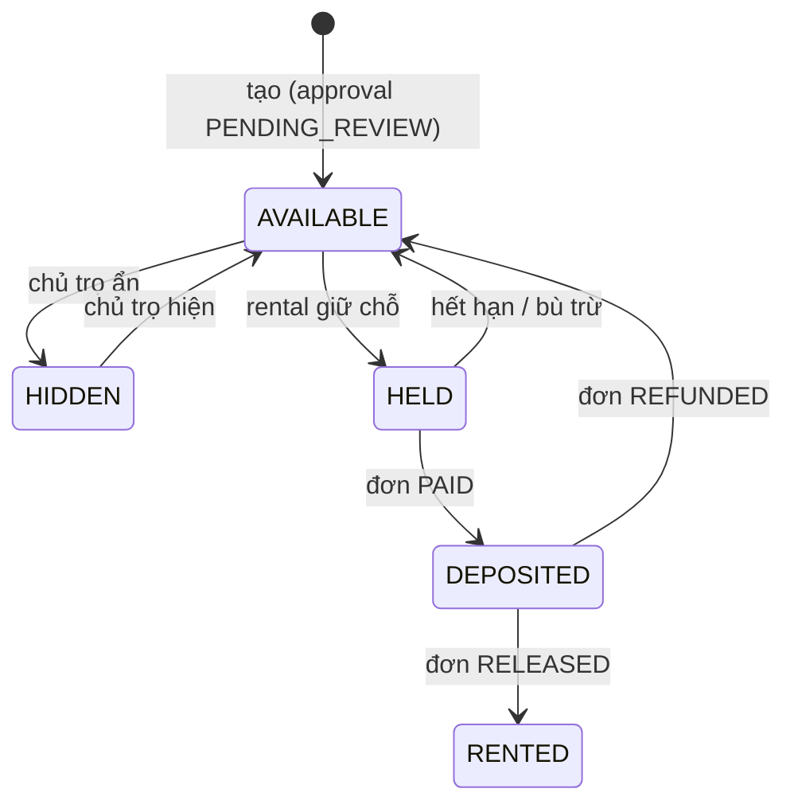
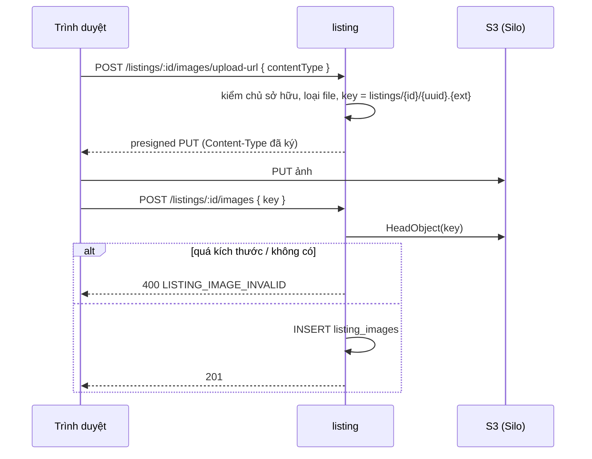
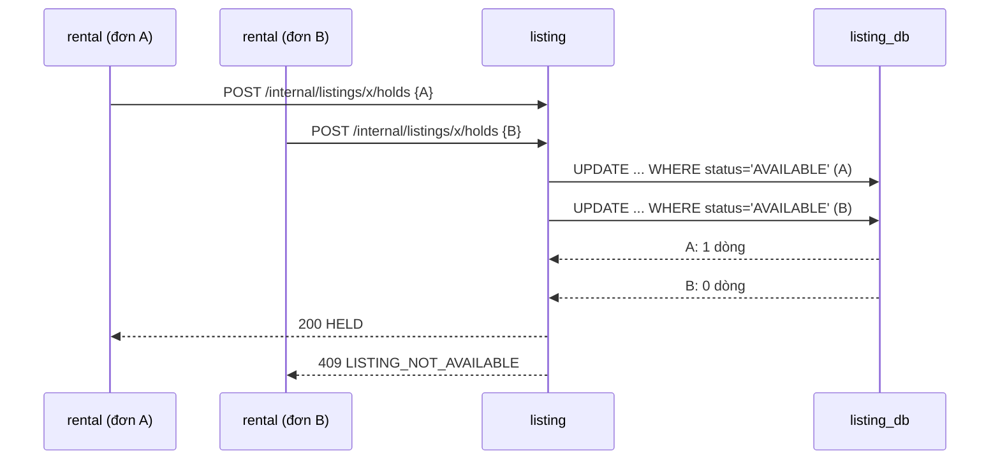

# RE.LISTING — Luồng xử lý

| | |
|---|---|
| **Chức năng** | Quản lý sản phẩm, tải ảnh, tìm kiếm, giữ chỗ và đổi trạng thái theo đơn |
| **Tham chiếu** | `API_Spec.md`, `Component_Class_Design.md`, ADR-0010 |
| **Chủ sở hữu / Cập nhật / Phiên bản** | hoang.lv — 2026-11-12 — v1.0 |

## 1. Vòng đời trạng thái BĐS

## 2. Tải ảnh

## 3. Giữ chỗ khi hai người cùng đặt cọc

Postgres khóa dòng khi `UPDATE`; lệnh thứ hai chờ rồi đánh giá lại `WHERE`, thấy `HELD` nên 0 dòng. Không cần khóa ứng dụng. Khóa Redis ở rental chỉ chặn bấm lặp sớm.

## 4. Xóa mềm

Một câu `UPDATE listings SET deleted_at = now() WHERE id AND owner_id AND status NOT IN ('HELD','DEPOSITED') AND deleted_at IS NULL`. 0 dòng → đọc lại để chọn `404`/`403`/`409`. Không có cửa sổ giữa kiểm tra và xóa.

## 5. Số truy vấn

| Endpoint | Truy vấn |
|---|---|
| Tìm kiếm | 2 (count + data có ảnh bìa qua join cùng DB) |
| Chi tiết | 2 (tin + ảnh) |
| Giữ chỗ | 1, cộng 1 khi 0 dòng để phân biệt gọi lại |
| Đổi trạng thái | 1, cộng 1 khi 0 dòng |
