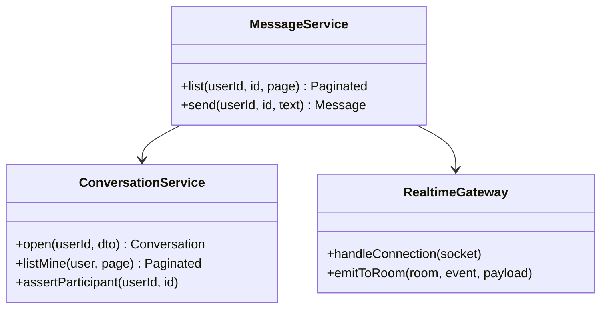

# RE.CHAT — Thiết kế thành phần

| | |
|---|---|
| **Service** | `services/notification/src/chat/` |
| **Quy ước** | `standards/coding-convention.md` |
| **Chủ sở hữu / Cập nhật / Phiên bản** | hoang.lv — 2026-11-12 — v1.0 |

## 1. Cấu trúc

```text
src/chat/
├─ chat.module.ts
├─ controllers/conversations.controller.ts
├─ services/conversation.service.ts   # open, list, assertParticipant
├─ services/message.service.ts        # list, send
├─ entities/ (conversation, conversation-participant, message)
└─ dto/
src/notification/realtime/realtime.gateway.ts   # dùng chung: xác thực socket, join phòng, emit
```

## 2. Sơ đồ lớp



`send`: transaction `INSERT messages` + `UPDATE conversations SET last_message_*`; sau commit `emitToRoom('conversation:<id>', 'message', …)`.

## 3. Test bắt buộc

| # | Tình huống | Mong đợi |
|---|---|---|
| 1 | Người không tham gia đọc tin | `403` (Báo cáo T15) |
| 2 | Mở hội thoại hai lần cùng cặp, cùng tin | Một hội thoại |
| 3 | Gửi tin | `201`, người còn lại nhận sự kiện `message` |
| 4 | Kết nối socket sai token | Bị ngắt |
| 5 | Danh sách | Sắp theo `last_message_at` |

## 4. Điểm [cần xác nhận]

Xem `API_Spec.md §5`.
