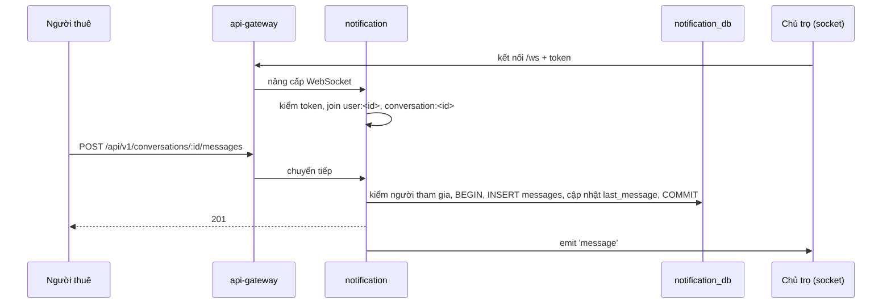

# RE.CHAT — Luồng xử lý

| | |
|---|---|
| **Chức năng** | Mở hội thoại, gửi và nhận tin, kênh hỗ trợ |
| **Tham chiếu** | `API_Spec.md`, `Component_Class_Design.md` |
| **Chủ sở hữu / Cập nhật / Phiên bản** | hoang.lv — 2026-11-16 — v1.1 |

## 1. Gửi tin

## 2. Chốt giờ xem nhà

Rental không lưu giờ hẹn xem (`RE.VIEWING`, chốt 2026-11-16). Sau khi đặt lịch, người thuê hoặc chủ trọ bấm nút Nhắn tin: giao diện gọi route 1 với `type = TENANT_LANDLORD`, `listingId` của tin; hội thoại đã có thì dùng lại. Notification không tự tạo hội thoại từ sự kiện lịch xem.

## 3. Kênh hỗ trợ

Người dùng mở hội thoại `SUPPORT` để hỏi quản trị viên, ví dụ khi đã chuyển tiền nhưng đơn hết hạn (BR-10). Quản trị viên tra `late_payments` ở payment rồi xử lý yêu cầu hoàn `SYSTEM` (`RE.PAYOUT`). Kênh chat không đổi dữ liệu tiền.

## 4. Khi phụ thuộc lỗi

| Lỗi | Kết quả |
|---|---|
| Notification dừng | Không nhắn tin được; luồng đặt cọc không ảnh hưởng |
| Socket rớt | Tin vẫn lưu; client tải lại bằng route 3 |

## 5. Số truy vấn

Gửi tin: kiểm người tham gia (1) + insert + update (2) = 3. Danh sách tin: 2.
