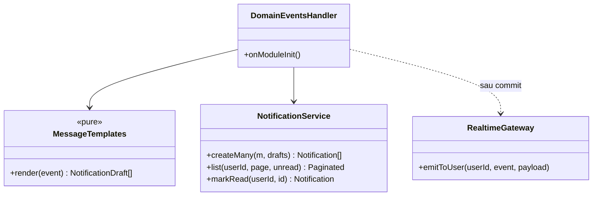

# RE.NOTIFICATION — Thiết kế thành phần

| | |
|---|---|
| **Service** | `services/notification/src/notification/` |
| **Quy ước** | `standards/coding-convention.md`, `design/SHARED/RE.MESSAGING/` |
| **Chủ sở hữu / Cập nhật / Phiên bản** | hoang.lv — 2026-11-16 — v1.1 |

## 1. Cấu trúc

```text
src/notification/
├─ notification.module.ts
├─ controllers/notifications.controller.ts
├─ services/notification.service.ts       # list, markRead, createMany(m, items)
├─ events/
│  ├─ domain-events.handler.ts            # đăng ký handler cho mọi eventType ở API_Spec §2
│  └─ message-templates.ts                # hàm thuần: event → [{ userId, type, title, body, data }]
├─ realtime/realtime.gateway.ts           # Socket.IO, dùng chung với RE.CHAT
├─ entities/notification.entity.ts
└─ errors/notification.errors.ts
```

## 2. Sơ đồ lớp



Handler ghi thông báo bằng `manager` của consumer (cùng transaction với `processed_events`). Đẩy WebSocket **sau commit**: handler trả danh sách thông báo đã tạo, consumer đẩy sau khi transaction xong; đẩy hỏng chỉ log `warn` (chốt 2026-11-16).

## 3. Test bắt buộc

| # | Tình huống | Mong đợi |
|---|---|---|
| 1 | `message-templates.spec.ts`: mỗi `eventType` | Đúng người nhận, `type`, có `deepLink` |
| 2 | Cùng sự kiện giao hai lần | Một thông báo mỗi người nhận (US07) |
| 3 | Sự kiện payload sai schema | DLQ (`NonRetryableEventError`) (E9) |
| 4 | Người A đánh dấu thông báo của B | `404` (Báo cáo T15) |
| 5 | Đánh dấu đã đọc hai lần | `200`, `read_at` không đổi |
| 6 | Danh sách | Chỉ của người gọi, phân trang, mới nhất trước |
| 7 | Notification dừng khi có sự kiện, bật lại | Thông báo đủ (E3) |

## 4. Đã chốt

Cơ chế đẩy sau commit (§2), 2026-11-16.
