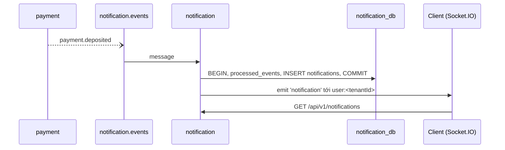

# RE.NOTIFICATION — Luồng xử lý

| | |
|---|---|
| **Chức năng** | Từ sự kiện tới thông báo, đẩy thời gian thực, khi phụ thuộc lỗi |
| **Tham chiếu** | `API_Spec.md`, `Component_Class_Design.md`, `RE.MESSAGING/Processing_Flow.md` |
| **Chủ sở hữu / Cập nhật / Phiên bản** | hoang.lv — 2026-11-12 — v1.0 |

## 1. Từ đặt cọc tới thông báo

Thông báo **không** quyết định kết quả nghiệp vụ: đơn đã `PAID` ở rental dù notification dừng.

## 2. Khi phụ thuộc lỗi

| Thành phần lỗi | Kết quả |
|---|---|
| Notification dừng | Message chờ trong queue; bật lại thì đủ (NFR08) |
| RabbitMQ dừng | Sự kiện nằm trong outbox của bên phát |
| DB notification lỗi | Thử lại 3 lần → DLQ; người phụ trách xử lý tay |
| Client không kết nối WebSocket | Thông báo vẫn trong DB, thấy khi mở danh sách |

## 3. Số truy vấn

Danh sách 2 (count + data). Đánh dấu đã đọc 1 (`UPDATE ... WHERE id AND user_id`), cộng 1 khi 0 dòng. Consumer 2–3 mỗi sự kiện.
