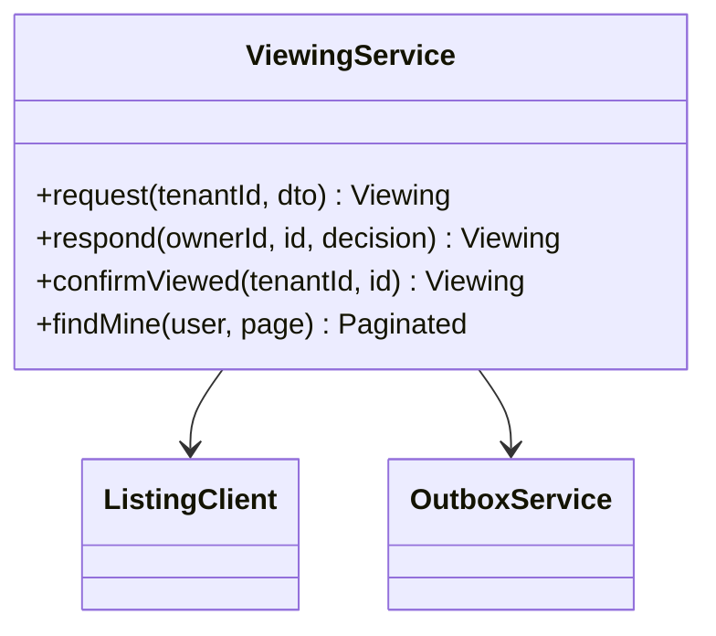

# RE.VIEWING — Thiết kế thành phần

| | |
|---|---|
| **Service** | `services/rental/src/rental/` (phần lịch xem) |
| **Quy ước** | `standards/coding-convention.md` |
| **Chủ sở hữu / Cập nhật / Phiên bản** | hoang.lv — 2026-11-12 — v1.0 |

## 1. Cấu trúc

```text
src/rental/
├─ controllers/viewings.controller.ts
├─ services/viewing.service.ts
├─ clients/listing.client.ts          # dùng chung với RE.DEPOSIT_SAGA
├─ entities/viewing.entity.ts
└─ dto/viewing.dto.ts
```

## 2. Sơ đồ lớp



Mỗi chuyển trạng thái: một transaction gồm `UPDATE viewings ... WHERE id AND status = <từ> AND <chủ>` + `outbox.add`. 0 dòng → đọc lại để chọn `404`/`403`/`409`.

## 3. Test bắt buộc

| # | Tình huống | Mong đợi |
|---|---|---|
| 1 | Đặt lịch tin chưa duyệt | `404` |
| 2 | Chủ trọ khác phản hồi | `403` |
| 3 | Xác nhận đã xem khi chưa `ACCEPTED` | `409` |
| 4 | Mỗi chuyển ghi đúng một sự kiện | Đúng schema |
| 5 | Danh sách của tôi | Chỉ lịch liên quan người gọi |

## 4. Điểm [cần xác nhận]

Xem `API_Spec.md §5`.
