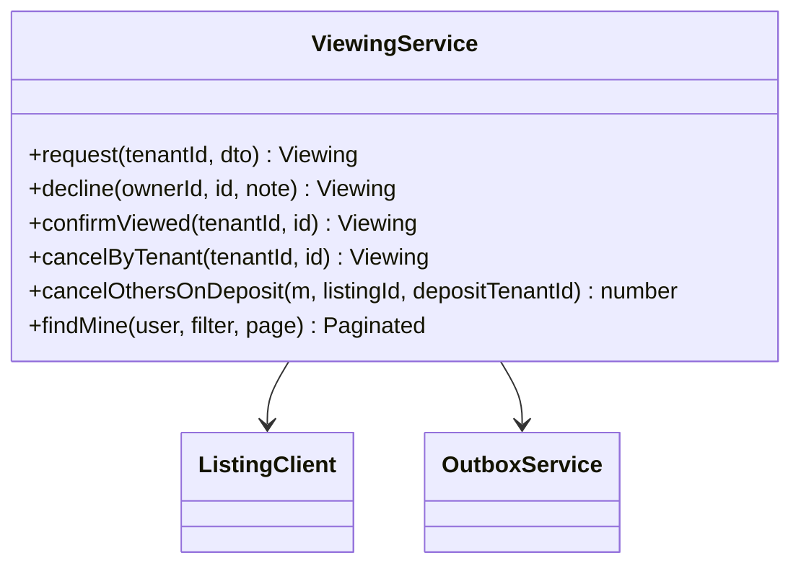

# RE.VIEWING — Thiết kế thành phần

| | |
|---|---|
| **Service** | `services/rental/src/rental/` (phần lịch xem) |
| **Quy ước** | `standards/coding-convention.md` |
| **Chủ sở hữu / Cập nhật / Phiên bản** | hoang.lv — 2026-11-16 — v1.1 |

## 1. Cấu trúc

```text
src/rental/
├─ controllers/viewings.controller.ts
├─ services/viewing.service.ts
├─ clients/listing.client.ts          # dùng chung với RE.DEPOSIT_SAGA
├─ entities/viewing.entity.ts
└─ dto/viewing.dto.ts
```

## 2. Sơ đồ lớp



Mỗi chuyển trạng thái do người dùng: một transaction gồm `UPDATE viewings ... WHERE id AND status = 'REQUESTED' AND <chủ>` + `outbox.add`. 0 dòng → đọc lại để chọn `404`/`403`/`409`.

`request`: insert vào `viewings`; vi phạm `ux_viewings_open_per_tenant` → `409 RENTAL_VIEWING_DUPLICATE`.

`cancelOthersOnDeposit` chạy **trong transaction** của handler `payment.deposited` (`RE.DEPOSIT_SAGA/Component_Class_Design.md §6`), dùng chung `EntityManager` `m`:

```sql
UPDATE viewings
   SET status = 'CANCELLED', cancel_reason = 'LISTING_DEPOSITED',
       cancelled_at = now(), updated_at = now()
 WHERE listing_id = $1 AND status = 'REQUESTED' AND tenant_id <> $2
RETURNING id, listing_id, tenant_id, owner_id;
```

Mỗi dòng trả về → một sự kiện `rental.viewing-cancelled` (`reason = LISTING_DEPOSITED`) vào outbox. Ghi outbox bằng `OutboxService.add(manager, …)` cho từng dòng, cùng transaction (chốt 2026-11-16). Không gọi HTTP.

## 3. Test bắt buộc

| # | Tình huống | Mong đợi |
|---|---|---|
| 1 | Đặt lịch tin chưa duyệt | `404` |
| 2 | Đặt lịch lần hai khi yêu cầu trước còn `REQUESTED` | `409 RENTAL_VIEWING_DUPLICATE` |
| 3 | Đặt lại sau khi yêu cầu trước đã `CANCELLED`/`DECLINED`/`CONFIRMED` | `201` |
| 4 | Chủ trọ khác từ chối | `403` |
| 5 | Xác nhận đã xem từ `REQUESTED` | `200`, `CONFIRMED` |
| 6 | Hủy khi đã `CONFIRMED` | `409` |
| 7 | `payment.deposited` cho tin có 3 yêu cầu `REQUESTED` (1 của người cọc) và 1 `CONFIRMED` | 2 yêu cầu `CANCELLED` `LISTING_DEPOSITED`, 2 sự kiện; yêu cầu của người cọc và yêu cầu `CONFIRMED` không đổi |
| 8 | `payment.deposited` giao hai lần | Lần hai không hủy thêm, không phát thêm sự kiện |
| 9 | Mỗi chuyển ghi đúng một sự kiện | Đúng schema |
| 10 | Danh sách của tôi | Chỉ lịch liên quan người gọi; chủ trọ lọc theo `listingId` |

## 4. Đã chốt

Xem `API_Spec.md §5` (2026-11-16).
