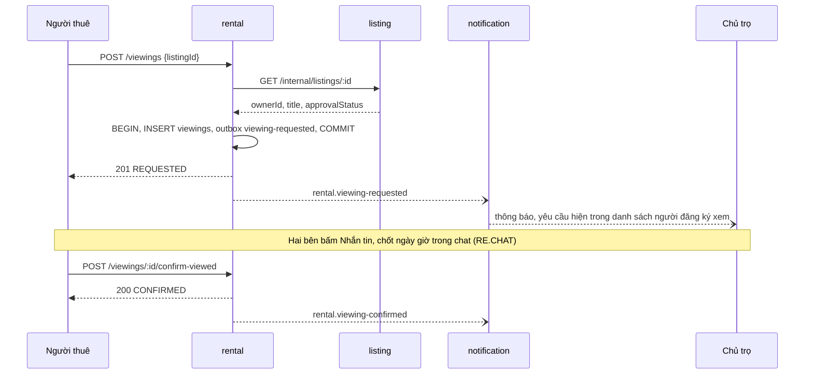
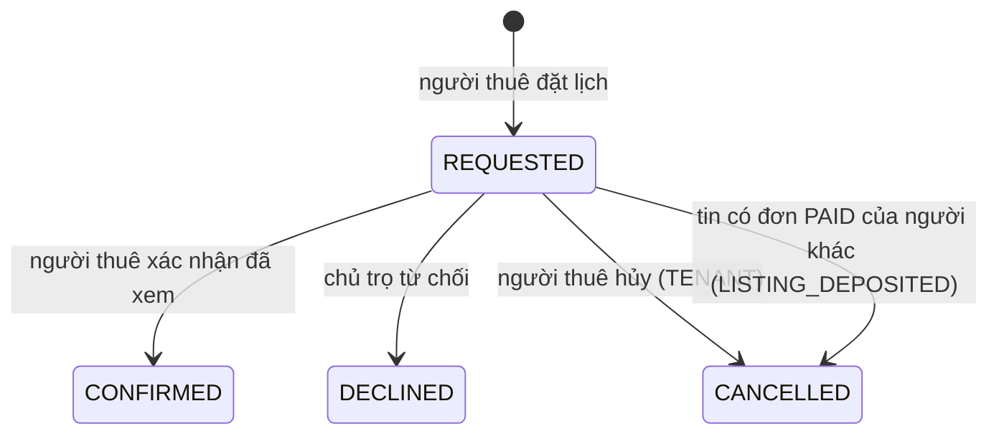
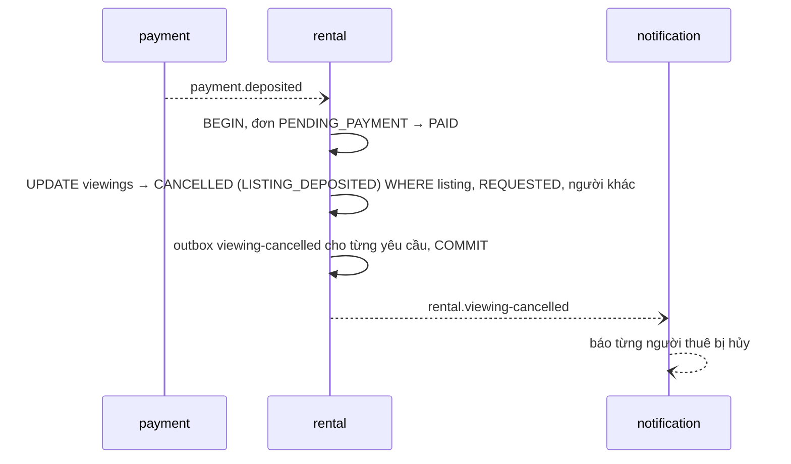

# RE.VIEWING — Luồng xử lý

| | |
|---|---|
| **Chức năng** | Đăng ký xem nhà, từ chối, hủy, xác nhận đã xem |
| **Tham chiếu** | `API_Spec.md`, `Component_Class_Design.md`, `RE.CHAT` |
| **Chủ sở hữu / Cập nhật / Phiên bản** | hoang.lv — 2026-11-16 — v1.1 |

## 1. Luồng

`CONFIRMED`, `DECLINED`, `CANCELLED` là trạng thái kết thúc. Chủ trọ không có bước đồng ý lịch; ngày giờ xem không lưu trong rental.

## 2. Tự hủy khi tin có người đặt cọc

Hủy nằm cùng transaction với `PAID`: không có trạng thái đơn đã `PAID` mà yêu cầu xem của người khác còn mở. Đơn chưa `PAID` (đang giữ chỗ 10 phút) không hủy gì.

## 3. Lỗi

| Điểm lỗi | Xử lý |
|---|---|
| Listing dừng khi đặt lịch | `503`/`504`, chưa ghi gì |
| Notification dừng | Lịch vẫn tạo; thông báo đến sau |
| Notification dừng khi tự hủy | Yêu cầu vẫn `CANCELLED`; sự kiện chờ trong outbox/queue |

## 4. Số truy vấn

Đặt lịch 2 (insert + outbox); chuyển trạng thái 2, cộng 1 khi 0 dòng. Tự hủy trong handler `payment.deposited`: thêm 1 `UPDATE ... RETURNING` + N câu outbox (một câu cho mỗi yêu cầu bị hủy).
