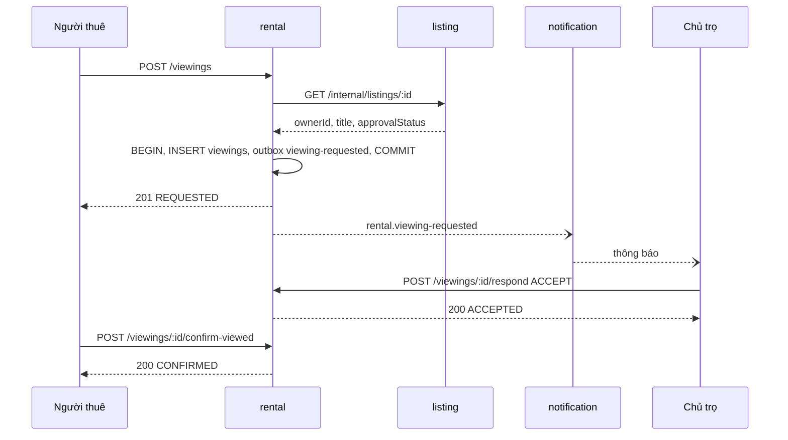
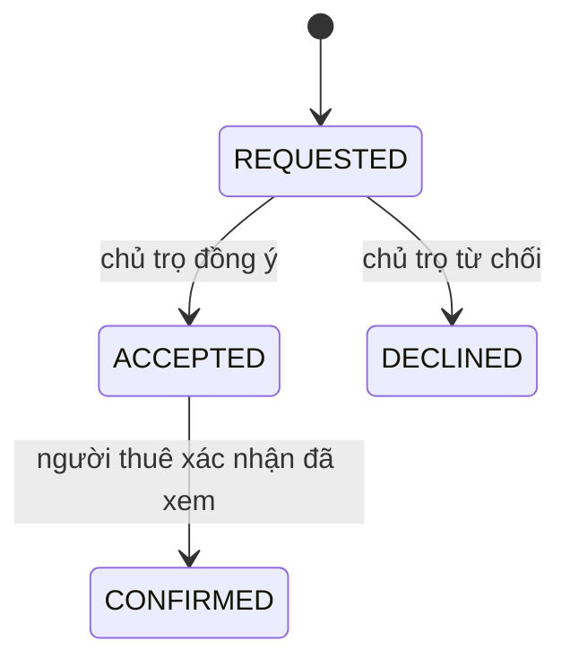

# RE.VIEWING — Luồng xử lý

| | |
|---|---|
| **Chức năng** | Đặt lịch, phản hồi, xác nhận đã xem |
| **Tham chiếu** | `API_Spec.md`, `Component_Class_Design.md` |
| **Chủ sở hữu / Cập nhật / Phiên bản** | hoang.lv — 2026-11-12 — v1.0 |

## 1. Luồng

## 2. Lỗi

| Điểm lỗi | Xử lý |
|---|---|
| Listing dừng khi đặt lịch | `503`/`504`, chưa ghi gì |
| Notification dừng | Lịch vẫn tạo; thông báo đến sau |

## 3. Số truy vấn

Đặt lịch 2 (insert + outbox); chuyển trạng thái 2, cộng 1 khi 0 dòng.
