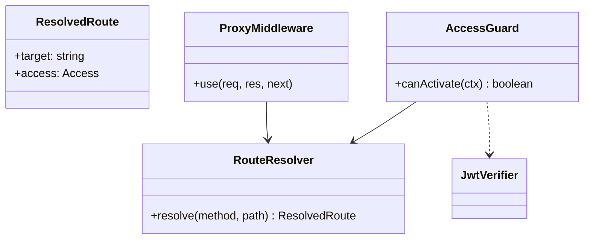

# RE.GATEWAY — Thiết kế thành phần

| | |
|---|---|
| **Service** | `services/api-gateway/` |
| **Quy ước** | `standards/coding-convention.md`, `standards/security-policy.md` |
| **Chủ sở hữu / Cập nhật / Phiên bản** | hoang.lv — 2026-11-16 — v1.1 |

## 1. Cấu trúc

Copy từ `_template-nest`, không bật `DATABASE_URL`, `RABBITMQ_URL`, `S3_ENDPOINT`.

```text
services/api-gateway/src/
├─ main.ts, app.module.ts, app.setup.ts
├─ common/ config/ health/            # giữ từ template
└─ gateway/
   ├─ gateway.module.ts
   ├─ routes.ts                      # bảng định tuyến API_Spec.md §3 (dữ liệu, không logic)
   ├─ route-resolver.ts              # khớp method + đường dẫn → { target, access }
   ├─ access.guard.ts                # kiểm JWT theo access; public/payos bỏ qua
   ├─ internal-block.middleware.ts   # /internal/* → 404
   ├─ throttle.config.ts             # @nestjs/throttler theo IP và sub, bộ đếm trong bộ nhớ
   ├─ proxy.middleware.ts            # http-proxy-middleware: chuyển tiếp, timeout, ws, đổi lỗi kết nối thành 503/504
   └─ errors/gateway.errors.ts       # GATEWAY_ROUTE_NOT_FOUND
```

## 2. Sơ đồ lớp



## 3. Thứ tự middleware

| # | Bước | Ghi chú |
|---|---|---|
| 1 | Correlation ID (template) | Sinh `X-Request-ID` nếu thiếu |
| 2 | Access log (template) | |
| 3 | `InternalBlockMiddleware` | `/internal/*` → `404 GATEWAY_ROUTE_NOT_FOUND` |
| 4 | CORS | |
| 5 | Throttler | `429` |
| 6 | `RouteResolver` | Không khớp → `404` |
| 7 | `AccessGuard` | `401`/`403` |
| 8 | `ProxyMiddleware` | Body không bị parse (body parser tắt ở `main.ts`), webhook giữ nguyên chữ ký |

## 4. Test bắt buộc

| # | Tình huống | Mong đợi |
|---|---|---|
| 1 | `GET /internal/listings/x` từ ngoài | `404`, không gọi service (Báo cáo T16) |
| 2 | Token sai chữ ký | `401 AUTH_TOKEN_INVALID` (Báo cáo T17) |
| 3 | Token hết hạn | `401 AUTH_TOKEN_EXPIRED` |
| 4 | `TENANT` gọi `/api/v1/admin/*` | `403 FORBIDDEN_ROLE` |
| 5 | Route `public` không token | Được chuyển tiếp |
| 6 | Webhook payOS không token | Được chuyển tiếp, body nguyên vẹn |
| 7 | Service đích tắt | `503 UPSTREAM_UNAVAILABLE` |
| 8 | Service đích chậm hơn timeout | `504 UPSTREAM_TIMEOUT` |
| 9 | `X-Request-ID` client gửi | Giống nhau ở log gateway và service đích |
| 10 | Vượt rate limit | `429` |
| 11 | Lỗi `409` của service | Chuyển nguyên `{ error, meta }` |
| 12 | Nâng cấp WebSocket `/ws` | Chuyển tới notification, không qua `AccessGuard` |

## 5. Đã chốt

Thư viện proxy, body thô, rate limit, WebSocket: `API_Spec.md §6` (2026-11-16).
