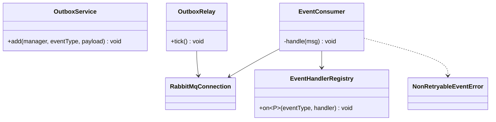

# RE.MESSAGING — Thiết kế thành phần

| | |
|---|---|
| **Service** | `src/messaging/` (từ `_template-nest`), `contracts/events/`, `infra/rabbitmq/definitions.json` |
| **Quy ước** | `standards/coding-convention.md §4`, `standards/reliability-standard.md §2` |
| **Chủ sở hữu / Cập nhật / Phiên bản** | hoang.lv — 2026-11-12 — v1.0 |

## 1. Cấu trúc

```text
src/messaging/
├─ messaging.module.ts
├─ rabbitmq.connection.ts      # amqp-connection-manager 5.0.0 (ghim)
├─ domain-event.ts             # dựng envelope, kiểm eventType
├─ outbox.service.ts           # add(manager, eventType, payload)
├─ outbox.relay.ts             # quét outbox_events, publish, đánh dấu published_at
├─ event-handler.registry.ts   # on(eventType, handler(event, manager))
├─ event.consumer.ts           # nhận, chống trùng, retry, DLQ
└─ entities/                   # outbox-event.entity.ts, processed-event.entity.ts
```

Handler nghiệp vụ đặt trong module của service: `src/<miền>/events/<nguồn>-events.handler.ts`.

## 2. Sơ đồ lớp



## 3. Cách dùng

**Phát** — trong cùng transaction với thay đổi dữ liệu:

```ts
await this.dataSource.transaction(async (m) => {
  await m.update(Deposit, { id, status: 'PENDING_PAYMENT' }, { status: 'EXPIRED' });
  await this.outbox.add(m, 'rental.deposit-expired', { depositId: id, listingId, tenantId, ownerId });
});
```

**Nhận** — mọi thay đổi dùng `manager` của handler (cùng transaction với `processed_events`), kiểm trạng thái hiện tại trước:

```ts
this.events.on<DepositPaidPayload>('payment.deposited', async (event, m) => {
  const r = await m.update(Deposit, { id: event.payload.depositId, status: 'PENDING_PAYMENT' }, { status: 'PAID', ... });
  if (!r.affected) return;            // đến muộn hoặc trùng: không làm gì
});
```

Handler **không** gọi HTTP (đang trong transaction). Việc cần gọi service khác → đánh dấu trên bản ghi, job làm sau (xem `RE.DEPOSIT_SAGA/Component_Class_Design.md`).

Dữ liệu sai, thử lại vô ích → `throw new NonRetryableEventError(...)` → DLQ ngay.

## 4. Thay đổi hạ tầng cần làm

| File | Việc |
|---|---|
| `infra/rabbitmq/definitions.json` | Thêm binding cho `rental.payment-events` (`API_Spec.md §3`); quyết định queue dự phòng |
| `infra/scripts/check-infra.*` | Cập nhật danh sách binding mong đợi |
| `contracts/events/` | Schema + example cho mọi sự kiện mới; cập nhật `payment.deposited`, `payment.refunded` theo payload v2 |
| `contracts/events/envelope.v1.schema.json` | Nới regex `eventType` nếu dùng khóa có gạch ngang |

## 5. Test bắt buộc

| # | Tình huống | Mong đợi |
|---|---|---|
| 1 | Ghi dữ liệu + outbox, rollback | Không có sự kiện |
| 2 | RabbitMQ tắt khi commit | Outbox giữ, relay gửi lại khi bật (E3) |
| 3 | Giao cùng `eventId` hai lần | Handler chạy một lần |
| 4 | Handler ném lỗi thường | Thử lại 3 lần rồi vào `<queue>.dlq` |
| 5 | `NonRetryableEventError` | Vào DLQ ngay |
| 6 | Sự kiện không có handler | Ack, bỏ qua |
| 7 | Payload mỗi sự kiện | `expectEventMatchesContract` pass |
| 8 | `correlationId` | Giữ nguyên từ request gốc qua consumer và sự kiện phát tiếp |

Template đã có test 1–6 ở `test/messaging.infra-spec.ts`; mỗi service thêm test 7 cho sự kiện của mình.

## 6. Điểm [cần xác nhận]

Xem `API_Spec.md §6`.
