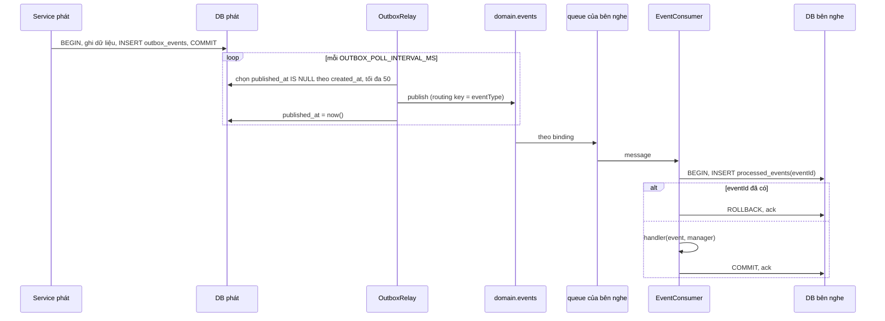
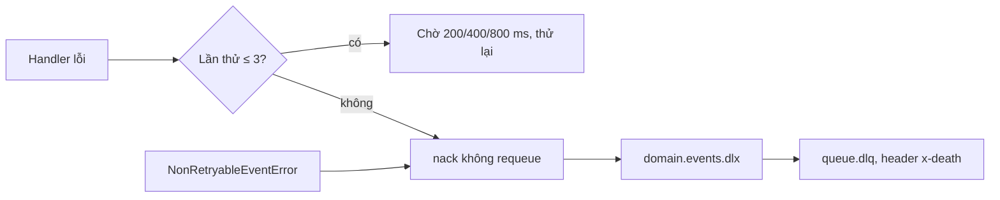

# RE.MESSAGING — Luồng xử lý

| | |
|---|---|
| **Chức năng** | Phát qua outbox, nhận chống trùng, thử lại, DLQ, RabbitMQ dừng |
| **Tham chiếu** | `API_Spec.md`, `Component_Class_Design.md`, ADR-0006 |
| **Chủ sở hữu / Cập nhật / Phiên bản** | hoang.lv — 2026-11-12 — v1.0 |

## 1. Phát và nhận

Giao **ít nhất một lần**. Relay gửi xong mà chưa kịp ghi `published_at` thì lần sau gửi lại; consumer chống trùng bằng `processed_events` nên kết quả như một lần.

## 2. Thử lại và DLQ

Message trong DLQ không tự xử lý lại; người phụ trách kiểm tra thủ công.

## 3. Bảng xử lý lỗi

| Điểm lỗi | Hậu quả | Xử lý |
|---|---|---|
| RabbitMQ dừng trước khi relay gửi | Sự kiện nằm trong outbox | Relay gửi bù khi RabbitMQ chạy lại (E3) |
| Service phát chết sau commit | Sự kiện nằm trong outbox | Khởi động lại, relay gửi tiếp |
| Bên nghe dừng | Message nằm trong queue | Bật lại thì xử lý |
| Bên nghe chết giữa handler | Transaction rollback, message chưa ack | Giao lại, chạy lại từ đầu |
| Sự kiện đến sai thứ tự hoặc muộn | Trạng thái hiện tại không khớp | `UPDATE` có điều kiện được 0 dòng → bỏ qua |
| Message hỏng | | DLQ (E9) |

## 4. Bất biến

| Bất biến | Kiểm tra |
|---|---|
| Không còn sự kiện chưa gửi khi RabbitMQ đã chạy | `select count(*) from outbox_events where published_at is null` = 0 |
| Mỗi sự kiện xử lý một lần mỗi bên nghe | Số dòng `processed_events` = số sự kiện duy nhất |
| DLQ chỉ chứa message cố ý làm hỏng | RabbitMQ UI |
