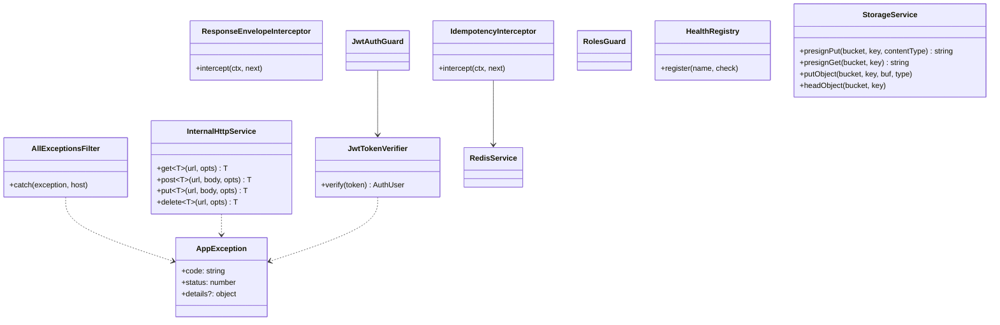

# RE.SERVICE_TEMPLATE — Thiết kế thành phần

| | |
|---|---|
| **Service** | `services/_template-nest/src/` |
| **Quy ước** | `standards/coding-convention.md`, `standards/reliability-standard.md` |
| **Chủ sở hữu / Cập nhật / Phiên bản** | hoang.lv — 2026-11-16 — v1.2 |

## 1. Cấu trúc

```text
src/
├─ main.ts                    # nạp env, logger, Swagger, shutdown hooks
├─ app.module.ts              # ghép module; DB/Redis/RabbitMQ/S3 chỉ bật khi có env
├─ app.setup.ts               # prefix /api/v1, middleware gắn bằng app.use (dùng chung main và test)
├─ swagger.setup.ts
├─ config/                    # env.bootstrap.ts, env.validation.ts (Joi), feature-flags.ts, service-info.ts
├─ common/
│  ├─ errors/                 # AppException, error-codes.ts, AllExceptionsFilter, createValidationPipe
│  ├─ logging/                # logger.module (pino), correlation-id.middleware, access-log.middleware
│  ├─ auth/                   # JwtAuthGuard, JwtTokenVerifier, RolesGuard, @Public, @Roles, @CurrentUser, jwt.config
│  ├─ idempotency/            # @Idempotent, IdempotencyInterceptor, request-fingerprint
│  ├─ http/                   # InternalHttpService, InternalHttpModule
│  ├─ response/               # ResponseEnvelopeInterceptor, @RawResponse, @ApiEnvelope, Paginated
│  └─ lifecycle/              # ShutdownLoggerService
├─ health/                    # HealthController, HealthRegistry
├─ database/                  # DatabaseModule, data-source.ts, transformers.ts, migrations/
├─ redis/                     # RedisModule, RedisService
├─ messaging/                 # xem RE.MESSAGING
├─ storage/                   # StorageService (S3: tạo bucket, presign PUT/GET, putObject)
├─ example/                   # MẪU — xóa khi tạo service thật
└─ scripts/export-openapi.ts
test/                         # *.e2e-spec.ts, *.infra-spec.ts, helpers/ (createTestApp, upstream giả, contracts)
```

## 2. Sơ đồ lớp



## 3. Tạo service mới

Làm theo `services/_template-nest/README.md §1` (PowerShell, robocopy). Việc bắt buộc sau khi copy:

| # | Việc |
|---|---|
| 1 | Đổi `name` trong `package.json` thành `@realestate/<service>`, `SERVICE_NAME`, `PORT` trong `.env.example`, đường dẫn trong `Dockerfile` |
| 2 | Xóa `src/example/`, `ExampleModule` trong `app.module.ts`, `test/example.e2e-spec.ts`, entity và migration mẫu |
| 3 | Giữ mọi `test/*.e2e-spec.ts` và `src/**/*.spec.ts` khác |
| 4 | Bật `DATABASE_URL` với user/DB riêng (`architecture.md §8`) |
| 5 | Viết module nghiệp vụ `src/<miền>/` theo `coding-convention.md §2` |
| 6 | Thêm service vào `infra/compose/docker-compose.yml` (profile `apps`) |
| 7 | Viết hợp đồng nội bộ vào `contracts/openapi/` trước khi code |

## 4. Quy tắc mở rộng template

- Sửa phần dùng chung → sửa ở `_template-nest` trước, rồi chép sang các service (không có package dùng chung, ADR-0014). PR do A duyệt.
- Không thêm entity, mã lỗi nghiệp vụ, client tới service cụ thể vào template.
- `JwtTokenVerifier` (v1.2): kiểm chữ ký, hạn, `iss` và claims (`sub`, `roles`, `exp`) của access token, ném `AppException` `AUTH_TOKEN_INVALID`/`AUTH_TOKEN_EXPIRED`. `JwtAuthGuard` gọi lại, hành vi giữ nguyên. Gateway dùng chung để không có bản kiểm token thứ hai (`RE.GATEWAY`).

## 5. Test bắt buộc

Đã có trong template, mọi service giữ nguyên và phải xanh:

| File | Kiểm tra |
|---|---|
| `test/errors.e2e-spec.ts` | Envelope lỗi, ẩn stack ở 5xx |
| `test/response-envelope.e2e-spec.ts` | `{ data, meta }`, phân trang, không bọc `/health` |
| `test/idempotency.e2e-spec.ts` | Replay, `422`, `409` |
| `test/http-client.e2e-spec.ts`, `http-client-defaults.e2e-spec.ts` | Retry, timeout, giữ nguyên `4xx`, truyền `X-Request-ID` |
| `test/logging.e2e-spec.ts` | Log JSON có `correlationId` |
| `test/health.e2e-spec.ts` | `200`/`503` theo phụ thuộc |
| `test/auth.e2e-spec.ts` | Guard JWT, vai trò (chạy qua `JwtTokenVerifier`, kết quả không đổi) |
| `test/messaging.infra-spec.ts` | Outbox, inbox, DLQ với RabbitMQ thật |
| `test/storage.infra-spec.ts` | Tạo bucket, presign |
