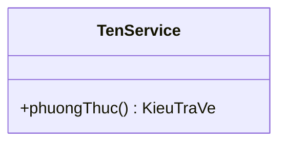

# RE.<TÊN> — Thiết kế thành phần

| | |
|---|---|
| **Service** | `services/<service>/src/<miền>/` |
| **Quy ước** | `standards/coding-convention.md` |
| **Chủ sở hữu / Cập nhật / Phiên bản** | <chủ sở hữu> — YYYY-MM-DD — v1.0 |

## 1. Cấu trúc

```text
src/<miền>/
```

## 2. Sơ đồ lớp



## 3. Hàm chính

Khung code chỉ hướng, chưa biên dịch.

## 4. Test bắt buộc

| # | Tình huống | Mong đợi |
|---|---|---|

## 5. Điểm [cần xác nhận]

> Chỉ giữ mục này khi tài liệu có điểm chưa chốt; không có thì xóa cả mục.

1.
