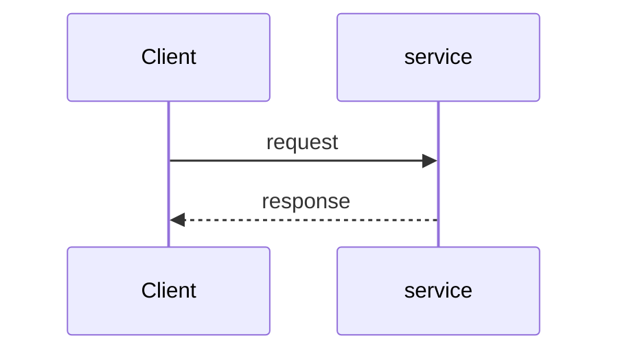

# RE.<TÊN> — Luồng xử lý

| | |
|---|---|
| **Chức năng** | <các luồng> |
| **Tham chiếu** | `API_Spec.md`, `Component_Class_Design.md`, ADR-NNNN |
| **Chủ sở hữu / Cập nhật / Phiên bản** | <chủ sở hữu> — YYYY-MM-DD — v1.0 |

## 1. Luồng thành công

## 2. Bảng xử lý lỗi

| Bước | Lỗi | Kết luận | Xử lý | Client nhận | Trạng thái |
|---|---|---|---|---|---|

## 3. Bất biến

| Bất biến | Cách kiểm tra |
|---|---|

## 4. Số truy vấn

| Endpoint | Truy vấn |
|---|---|

## 5. Điểm [cần xác nhận]

> Chỉ giữ mục này khi tài liệu có điểm chưa chốt; không có thì xóa cả mục.

1.
