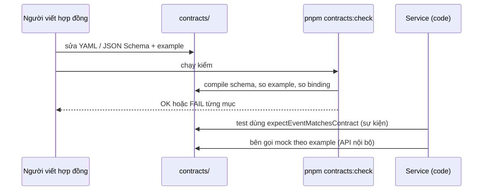

# Giải thích code — Hợp đồng nội bộ và sự kiện (`contracts/`)

> Theo khuôn `guides/_template_Code_Walkthrough.md`.
> Đọc khi: cần hiểu `contracts/`, thêm hoặc đổi API nội bộ, sự kiện, binding RabbitMQ; chuẩn bị vấn đáp phần contract-first.

| | |
|---|---|
| **Chủ sở hữu / Cập nhật** | hoang.lv — 2026-11-13 |
| **Thành phần** | `contracts/`, `infra/rabbitmq/definitions.json`, `infra/scripts/check-infra.*`, `src/messaging/domain-event.ts` của `_template-nest` và `identity` |
| **Task** | T0.3, T0.4 (`implementation/PHASE-0.md`) |
| **Thiết kế** | `design/SHARED/RE.MESSAGING/`, mục "API nội bộ" của `RE.LISTING`, `RE.DEPOSIT_LIFECYCLE`, `RE.PAYMENT`, `RE.PAYOUT`, `RE.IDENTITY` |
| **Commit / PR** | `[cần xác nhận]` mã commit sau khi merge |

## 1. Luồng chung

Hợp đồng viết trước code (ADR-0012). Bên cung cấp và bên gọi là hai người khác nhau, nên cả hai code song song theo cùng một file: bên gọi mock theo `example`, bên cung cấp viết controller cho khớp schema. `pnpm contracts:check` chạy ở máy và CI để chặn file hỏng. Sự kiện đi qua exchange `domain.events`; `definitions.json` quyết định queue nào nhận khóa nào, `check-infra.*` kiểm RabbitMQ đang chạy có đúng topology đó.



## 2. Cây thư mục

```text
contracts/
├─ openapi/
│  ├─ README.md
│  ├─ listing-internal.v1.yaml     # S1: rental → listing
│  ├─ payment-internal.v1.yaml     # S2: rental → payment
│  ├─ identity-internal.v1.yaml    # S3: payment → identity
│  └─ rental-internal.v1.yaml      # S4: payment → rental
├─ events/
│  ├─ README.md
│  ├─ envelope.v1.schema.json
│  ├─ <miền>.<sự-kiện>.v1.schema.json   # 17 sự kiện
│  └─ examples/<miền>.<sự-kiện>.v1.json
└─ scripts/
   ├─ check-events.mjs
   └─ check-openapi.mjs
infra/rabbitmq/definitions.json
infra/scripts/check-infra.ps1, check-infra.sh
services/_template-nest/src/messaging/domain-event.ts (+ spec)
services/identity/src/messaging/domain-event.ts (+ spec, bản copy)
```

## 3. Chức năng từng file

| File | Làm gì | Gọi tới / được gọi bởi | Ghi chú |
|---|---|---|---|
| `openapi/listing-internal.v1.yaml` | Đọc bản chụp tin (`ownerId`, `title`, `depositAmountVnd`, `status`, `approvalStatus`), giữ chỗ `POST .../holds`, đổi trạng thái `PUT .../status` | rental `ListingClient` gọi; listing B cung cấp | Giữ chỗ không retry; đổi trạng thái idempotent theo `depositId` |
| `openapi/payment-internal.v1.yaml` | Tạo, tra cứu, hủy payment order; tạo yêu cầu hoàn 70% | rental `PaymentClient` gọi; payment C cung cấp | Mọi lệnh idempotent theo `depositId`, nên POST cũng được retry |
| `openapi/identity-internal.v1.yaml` | Lấy tài khoản nhận tiền đầy đủ | payment `IdentityClient` gọi; identity A cung cấp | Không log `accountNumber` |
| `openapi/rental-internal.v1.yaml` | Điều kiện rút `withdrawal-eligibility` | payment `RentalClient` gọi; rental C cung cấp | Có nhánh đơn `REFUNDED` (BR-15 sửa) |
| `openapi/README.md` | Bảng 4 file, quy ước, cách đổi hợp đồng | Người đọc | Bảng phủ S1–S4 ở `architecture.md §7.1` |
| `events/envelope.v1.schema.json` | Phong bì chung; `eventType` theo `^[a-z]+\.[a-z-]+$` | Mọi schema sự kiện `$ref` tới | Nới regex theo A4 |
| `events/*.v1.schema.json` (17 file) | Payload từng sự kiện, `additionalProperties: false` | `check-events.mjs`, `test/helpers/contracts.ts` | Danh sách ở `events/README.md` |
| `events/examples/*.json` | Ví dụ hợp lệ cho từng sự kiện | `check-events.mjs` | Một file mỗi sự kiện |
| `events/README.md` | Phong bì, danh sách sự kiện, quy tắc producer/consumer, cách đổi schema | Người đọc | Ghi ngoại lệ viết lại `v1` một lần |
| `scripts/check-events.mjs` | Compile schema, so example, thử thiếu/thừa trường, đối chiếu binding ↔ schema, mỗi sự kiện có queue nhận | `pnpm contracts:check` | Sửa regex tên file cho gạch ngang |
| `scripts/check-openapi.mjs` | OpenAPI 3.1, `$ref` không gãy, mọi example (response, request body, response dùng chung) khớp schema | `pnpm contracts:check` | Thêm kiểm request body và `components/responses` |
| `infra/rabbitmq/definitions.json` | Exchange, queue, binding nạp bằng `rabbitmq-init` | RabbitMQ khi khởi động | Còn 2 queue: `notification.events`, `rental.payment-events` (+ DLQ) |
| `infra/scripts/check-infra.ps1`, `.sh` | Kiểm queue, DLQ, binding thực tế khớp mong đợi | `pnpm infra:check` | So khóa theo thứ tự mã ký tự (ordinal) |
| `src/messaging/domain-event.ts` | `buildDomainEvent`, `checkEnvelope`, `EVENT_TYPE_PATTERN` | `OutboxService`, consumer | Template sửa trước, identity copy y hệt (ADR-0014) |
| `src/messaging/domain-event.spec.ts` | Test chấp nhận gạch ngang, từ chối sai định dạng | Jest | Test mới viết trước (đỏ) rồi mới sửa regex |
| `test/messaging.infra-spec.ts` | Test `expectEventMatchesContract` với `rental.deposit-created` | Jest infra (Postgres, RabbitMQ thật) | Thay ví dụ `rental.requested` đã xóa |
| `test/helpers/contracts.ts` | Nạp schema từ `contracts/events/` để test | Test các service | Chỉ đổi ví dụ trong chú thích |

## 4. Quyết định không hiển nhiên

| Quyết định | Lý do | Phương án đã loại | Căn cứ |
|---|---|---|---|
| Viết lại `v1` của `payment.deposited`, `payment.refunded` | Chưa service nào phát hay nghe, tạo `v2` chỉ thêm file chết | Tạo `v2` đúng quy tắc chữ | `van-de-can-quyet-dinh.md` D 2026-11-13 |
| Đổi tên trường listing sang `ownerId`, `depositAmountVnd`, bỏ `landlordName` | Thống nhất thuật ngữ; listing không có nguồn tên chủ trọ | Giữ tên cũ | `domain-glossary.md` Từ chuẩn |
| Rental chưa bind `withdrawal-requested`, `withdrawal-failed` | Chưa chốt rental làm gì (C10); queue chỉ nhận khóa có handler | Bind và chỉ log | D 2026-11-13 |
| Thêm `tenantId` vào `deposit-handed-over`, `deposit-released`, `release-reminder` | Quy tắc "mọi sự kiện rental mang đủ `tenantId`, `ownerId`" của `RE.MESSAGING §3` | Giữ đúng Bảng 3.13 | `RE.MESSAGING §3` |
| So binding theo thứ tự ordinal trong `check-infra.ps1` | `Sort-Object` theo văn hóa xếp `refund-rejected` khác `LC_ALL=C sort`, hai script cho kết quả khác nhau | Giữ `Sort-Object` | Kiểm thử thủ công thứ tự |
| Bên kiểm OpenAPI đọc cả request body và `components/responses` | Trước đây response `$ref` bị bỏ qua không kiểm | Lặp lại response ở từng route | `check-openapi.mjs` |

## 5. Câu hỏi vấn đáp

| Câu hỏi | Trả lời ngắn | Xem thêm |
|---|---|---|
| Vì sao API nội bộ viết tay, API công khai sinh từ code? | Nội bộ có hai người ở hai đầu, phải chốt trước; công khai một người làm cả hai đầu | `contracts/openapi/README.md` |
| Thêm trường vào sự kiện thì sao? | Không bắt buộc: sửa `v1`; bắt buộc hoặc đổi nghĩa: tạo `v2`, phát song song | `contracts/events/README.md` |
| Làm sao biết sự kiện có người nghe? | `check-events.mjs` báo lỗi nếu sự kiện không khớp binding nào | `definitions.json` |
| Vì sao POST tạo payment order được retry? | Idempotent theo `depositId` (duy nhất trong `payment_orders`) | `reliability-standard.md §3` |
| Giữ chỗ lỗi timeout thì sao? | Không retry; `heldUntil` tự hết, listing coi chỗ quá hạn là trống (A9) | `RE.LISTING §2.1` |

## 6. Hạn chế đã biết

| Hạn chế | Ảnh hưởng | Hướng xử lý |
|---|---|---|
| Tên trạng thái payment order, duyệt tin, lịch xem còn là đề xuất | Đổi tên sau này phải sửa schema và example | Chốt các mục C1–C3 trong `van-de-can-quyet-dinh.md` |
| `check-infra.ps1` chưa chạy thử sau khi sửa (cloud không có PowerShell) | Lỗi cú pháp chỉ lộ khi chạy `pnpm infra:check` | Chạy trên máy Windows trước khi merge |
| `messaging.infra-spec.ts` cần Postgres, RabbitMQ thật | Chưa chạy ở bước viết hợp đồng | Chạy `test:infra` của template và identity |
