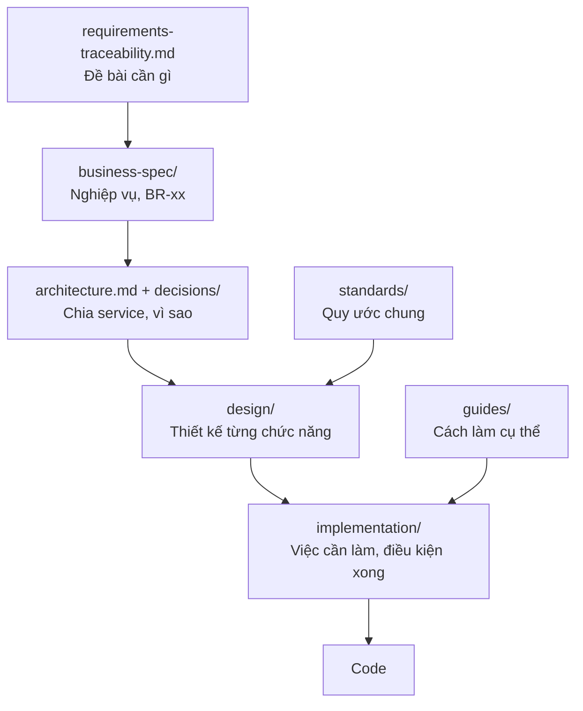

# Hướng dẫn đọc thiết kế và chuyển sang code

> Đọc xong biết đọc gì trước, ký hiệu nghĩa là gì, biến thiết kế thành code thế nào.
> File này chỉ hướng dẫn cách đọc. Nội dung chi tiết nằm trong tài liệu được trỏ tới.

| | |
|---|---|
| **Chủ sở hữu / Cập nhật** | hoang.lv — 2026-11-12 |

## 1. Dự án đang ở đâu

Real-estate là nền tảng thuê nhà, đặt cọc qua payOS vào ví trung gian. Hệ thống **viết mới** theo microservices, không có ứng dụng cũ để chép.

| Thành phần | Trạng thái |
|---|---|
| `services/_template-nest` | Có, kèm test. Khung kỹ thuật mọi service copy từ đây |
| `services/identity` | Có: đăng ký, đăng nhập, làm mới, đăng xuất, `/me` |
| `infra/`, `contracts/` | Có (hợp đồng phiên bản đầu theo luồng cũ, sẽ viết lại ở Phase 0) |
| `api-gateway`, `listing`, `rental`, `payment`, `notification` | **Chưa có code** |
| `project-knowledge/` | Tài liệu thiết kế v1.0, nhiều điểm `[cần xác nhận]` |

Tiến độ thật ở `implementation/progress.md`.

## 2. Cần biết gì trước

| Bắt buộc | Nên biết |
|---|---|
| TypeScript | NestJS: module, controller, service, guard, interceptor |
| REST, HTTP status | TypeORM, migration |
| SQL, transaction | Docker Compose |
| Git | RabbitMQ (khi làm sự kiện), PostGIS (khi làm listing) |

Cài Node.js 22, pnpm ≥ 10 (`corepack enable`), Docker Desktop, Git.

**8 khái niệm cần hiểu.** Định nghĩa đầy đủ ở `domain-glossary.md`.

| Khái niệm | Hiểu nhanh |
|---|---|
| Gateway | Cửa vào duy nhất cổng 8080, kiểm JWT rồi chuyển request |
| API nội bộ | `/internal/*`, chỉ service gọi nhau |
| Giữ chỗ | `UPDATE ... WHERE status='AVAILABLE'`: hai người cùng bấm thì chỉ một người thắng |
| Bản chụp | Lưu sẵn tiền cọc, tiêu đề vào đơn, không JOIN qua database khác |
| Idempotent | Gọi lại cùng khóa cho kết quả như một lần; `Idempotency-Key` |
| Saga | Việc qua nhiều service không có transaction chung; lỗi giữa chừng thì bù trừ |
| Outbox | Ghi sự kiện cùng transaction với dữ liệu, gửi sau |
| Webhook | payOS gọi ngược báo tiền đã vào; là bằng chứng thanh toán duy nhất |

## 3. Bản đồ tài liệu

| Thư mục | Trả lời | Khi nào mở |
|---|---|---|
| `business-spec/` | Hệ thống phải làm gì? | Không hiểu vì sao có một quy tắc |
| `architecture.md` | Service nào giữ dữ liệu gì? | Đọc một lần |
| `decisions/` | Vì sao chọn cách này? | Gặp lựa chọn lạ, chuẩn bị vấn đáp |
| `standards/` | Quy ước API, code, Git, độ tin cậy | Trước khi viết code |
| `design/` | Chức năng xây thế nào? | **Mở nhiều nhất** |
| `implementation/` | Làm gì tiếp, thế nào là xong? | Mỗi khi nhận task |
| `guides/` | Làm từng thao tác ra sao? | Chạy Docker, viết Postman, đo lỗi |

## 4. Đọc theo thứ tự nào

### Lượt 1: toàn cảnh, khoảng 30 phút

1. `architecture.md §2–4`.
2. `business-spec/RE.BUSINESS_RULES.md §4–5`.
3. `domain-glossary.md`, đọc lướt.

Trả lời được: có mấy service, đơn đặt cọc có những trạng thái nào, vì sao rental không đọc thẳng bảng `listings`.

### Lượt 2: quy ước, khoảng 30 phút

1. `standards/api-convention.md`
2. `standards/coding-convention.md`
3. `standards/reliability-standard.md §3–4`
4. `services/_template-nest/README.md` và `design/SHARED/RE.SERVICE_TEMPLATE/API_Spec.md`

### Lượt 3: đúng phần mình làm

1. `implementation/progress.md` → chọn task.
2. Mở task trong `implementation/PHASE-x.md`, đọc đúng các file ở dòng **Đọc trước**.
3. Gặp `[cần xác nhận]` chặn task → xem `implementation/van-de-can-quyet-dinh.md`, hỏi người phụ trách.

**Luồng khó nhất:** `design/RENTAL/RE.DEPOSIT_SAGA/Processing_Flow.md`.

## 5. Ký hiệu

| Ký hiệu | Nghĩa | Ví dụ |
|---|---|---|
| `T3.2` | Mã task (có dấu chấm) | `implementation/PHASE-3.md` |
| `E4-2` | Mã task trong kế hoạch sprint xlsx | Cột "Mã WBS" |
| `BR-06` | Quy tắc nghiệp vụ | `RE.BUSINESS_RULES.md §4` |
| `ADR-0004` | Quyết định kiến trúc | `decisions/` |
| `RE.DEPOSIT_SAGA` | Mã chức năng = thư mục thiết kế | `design/RENTAL/RE.DEPOSIT_SAGA/` |
| `LISTING_NOT_AVAILABLE` | Mã lỗi trả client | Catalog trong `API_Spec.md` |
| Báo cáo `T01`–`T18`, `E1`–`E10` | Ca kiểm thử, thí nghiệm của báo cáo; luôn viết kèm chữ "Báo cáo" | Báo cáo Bảng 5.2, 5.4 |
| `X1`–`X5` | Phần mở rộng ngoài lộ trình (WBS E9-1…E9-5) | `implementation/README.md §6` |
| `[cần xác nhận]` | Chưa chốt | Hỏi, đừng đoán |
| public / user / tenant / landlord / admin / payos | Mức truy cập | `RE.GATEWAY/API_Spec.md §2` |

## 6. Đọc một bộ thiết kế

| Thứ tự | File | Câu hỏi | Tìm gì |
|---|---|---|---|
| 1 | `API_Spec.md` | Bên ngoài thấy gì? | Endpoint, thứ tự kiểm tra, mã lỗi, DDL |
| 2 | `Processing_Flow.md` | Chạy theo thứ tự nào? | Sơ đồ tuần tự, bảng lỗi, bất biến |
| 3 | `Component_Class_Design.md` | Viết code ở đâu? | Thư mục, khung code, **test bắt buộc** |

## 7. Từ thiết kế sang code

| Thấy | Viết thành |
|---|---|
| Bảng endpoint | Route trong controller (`@Roles`, `@Idempotent`, `@ApiEnvelope`) |
| Bảng trường request | DTO `class-validator` |
| **Thứ tự kiểm tra** | Các `if` trong service, **đúng thứ tự** |
| **Catalog mã lỗi** | `src/<miền>/errors/<miền>.errors.ts`, ném `AppException` |
| **DDL** | Entity + migration |
| **Biến môi trường** | `env.validation.ts`, `.env.example`, compose |
| Phần **Transaction** | `dataSource.transaction(...)` + `outbox.add(m, …)` |
| Phần **Đồng thời** | `UPDATE ... WHERE` có điều kiện, unique index, khóa Redis |
| **Lời gọi ra ngoài** | Class trong `clients/` dùng `InternalHttpService` |
| **Test bắt buộc** | `*.spec.ts`, `*.infra-spec.ts`. Viết test trước |

Khung code trong thiết kế chỉ hướng, chưa biên dịch.

## 8. Khi tài liệu chưa rõ hoặc sai

| Tình huống | Làm gì |
|---|---|
| Không hiểu vì sao thiết kế như vậy | ADR trong `decisions/` |
| Gặp `[cần xác nhận]` | `implementation/van-de-can-quyet-dinh.md`, hỏi người phụ trách (`implementation/README.md §2`) |
| Thiết kế khác Báo cáo v2 | Báo cáo v2 thắng; ghi vào `van-de-can-quyet-dinh.md` |
| Thiết kế sai hoặc thiếu | **Sửa tài liệu trước** (sau baseline thì thêm `CHANGELOG.md`), rồi sửa code |
| Muốn đổi API nội bộ, sự kiện | Sửa `contracts/` trong cùng PR, bên gọi duyệt |

## 9. Lỗi hay gặp

| Lỗi | Hậu quả | Thay bằng |
|---|---|---|
| Import entity của service khác | Phá ranh giới | API nội bộ qua `clients/` |
| Gọi `axios` trực tiếp | Không timeout, retry, `X-Request-ID` | `InternalHttpService` |
| Gọi HTTP trong transaction hoặc trong handler sự kiện | Cạn kết nối DB | Đánh dấu, job làm sau |
| Đọc trạng thái rồi mới ghi | Hai người cùng giữ chỗ | `UPDATE ... WHERE status=…` |
| Nhận số tiền từ client | Vi phạm BR-04 | Lấy từ bản chụp |
| Coi `returnUrl` của payOS là đã trả tiền | Ghi nhận sai | Chỉ webhook hợp lệ |
| Dùng mock cho test đồng thời | Test luôn pass | Postgres thật (`test:infra`) |
| Coi task xong vì build được | Lỗi lúc tích hợp | Chạy **Kiểm chứng**, đối chiếu **DoD** |

## 10. Tự kiểm tra trước khi nhận task

- [ ] Kể được 5 service + gateway và dữ liệu mỗi service giữ.
- [ ] Vẽ được máy trạng thái đơn đặt cọc.
- [ ] Phân biệt `4xx` với `503`, `504`; biết lệnh nào được retry.
- [ ] Giải thích được vì sao ba lớp chặn đặt cọc trùng.
- [ ] Biết tìm mã lỗi, `BR-xx`, ADR ở đâu.

## 11. Đọc tiếp

| Muốn | Đọc |
|---|---|
| Tạo service mới | `services/_template-nest/README.md §1`, `RE.SERVICE_TEMPLATE/Component_Class_Design.md §3` |
| Chạy hệ thống | `guides/RE_Docker_Local_Guide.md` |
| OpenAPI, Postman, CI | `guides/RE_OpenAPI_Postman_Guide.md` |
| Thí nghiệm lỗi | `guides/RE_Failure_Experiment_Guide.md` |
| Báo cáo, vấn đáp | `guides/RE_Report_Defense_Guide.md` |
| Git, PR | `standards/git-workflow.md` |
