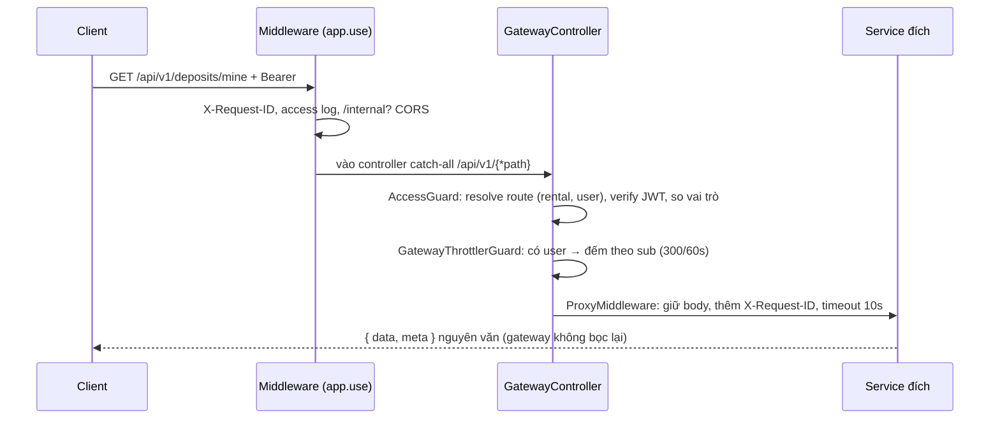

# Giải thích code — api-gateway

> Viết khi task có code đã PASS test và lệnh kiểm chứng, trước `code-review` và commit (`CLAUDE.md` gốc §8).
> Đọc khi: cần hiểu code của gateway để sửa tiếp (thêm route, đổi mức truy cập), review, hoặc chuẩn bị vấn đáp.

| | |
|---|---|
| **Chủ sở hữu / Cập nhật** | hoang.lv — 2026-11-17 |
| **Thành phần** | `services/api-gateway/` (cổng 8080) |
| **Task** | `T1.2` (`implementation/PHASE-1.md`); T1.3 nối compose |
| **Thiết kế** | `design/SHARED/RE.GATEWAY/` (v1.3), `design/SHARED/RE.SERVICE_TEMPLATE/` (v1.2), ADR-0003 |
| **Commit / PR** | `19fdd27` (thiết kế v1.2), `3e2e62b` (vá template), `cae44a9` (scaffold), `4fccabf` (thiết kế v1.3), `a090160` (code gateway); PR chưa mở |

## 1. Luồng chung

Gateway là cửa vào duy nhất (ADR-0003): client chỉ gọi cổng 8080. Một request đi qua middleware (mã truy vết, log, chặn `/internal/*`, CORS), rồi vào `GatewayController` duy nhất: `AccessGuard` khớp bảng định tuyến và kiểm JWT RS256 bằng khóa công khai (không gọi identity), `GatewayThrottlerGuard` đếm rate limit, `ProxyMiddleware` chuyển tiếp **nguyên byte** tới service đích. Gateway không có nghiệp vụ, không DB, không retry. Lỗi 4xx/5xx của service đi nguyên văn; gateway chỉ tự tạo 401/403/404/429/503/504.



Hai đường không đi qua controller: `GET /health` (route riêng) và WebSocket `/ws` (sự kiện `upgrade` của HTTP server, chỉ `/ws`, không qua guard; notification kiểm token ở handshake).

## 2. Cây thư mục

```text
services/api-gateway/
├─ src/
│  ├─ main.ts                 # bodyParser: false, listen
│  ├─ app.module.ts           # AppModule: thêm GatewayModule sau HealthModule
│  ├─ app.setup.ts            # trust proxy, middleware, CORS, prefix, nối upgrade /ws
│  ├─ gateway/                # PHẦN RIÊNG CỦA GATEWAY
│  │  ├─ routes.ts            # bảng định tuyến (dữ liệu)
│  │  ├─ route-resolver.ts    # method + đường dẫn → { service, target, access }
│  │  ├─ internal-block.middleware.ts
│  │  ├─ access.guard.ts
│  │  ├─ gateway-throttler.guard.ts + throttle.config.ts
│  │  ├─ proxy.middleware.ts
│  │  ├─ gateway.controller.ts, gateway.module.ts
│  │  ├─ route-not-found.filter.ts
│  │  └─ errors/gateway.errors.ts
│  ├─ common/ config/ health/ # chép từ _template-nest (config/ thêm biến gateway)
│  └─ database/ messaging/ redis/ storage/   # chép từ template, KHÔNG bật (không đặt env)
├─ test/                      # gateway*.e2e-spec.ts, app-setup, cors-origins + test kế thừa
├─ .env.example, Dockerfile, Dockerfile.dockerignore, package.json, ...
```

## 3. Chức năng từng file

### 3.1 Phần riêng của gateway

| File | Làm gì | Gọi tới / được gọi bởi | Ghi chú |
|---|---|---|---|
| `src/gateway/routes.ts` | Bảng 22 dòng `{ methods?, pattern, service, access }` theo `API_Spec §3`; kiểu `Access`, `ServiceName`; `SERVICE_ENV_URL` (service → biến `INTERNAL_<SERVICE>_URL`) | `RouteResolver` | Dữ liệu, không logic. Dòng cụ thể đứng TRƯỚC dòng chung (`/listings/mine` trước `/listings/:id`; webhook trước `/payments/*`) |
| `src/gateway/routes.spec.ts` | Bảng hợp lệ: không trùng, `/*` chỉ ở cuối, chỉ webhook là `payos`, tập route mở (không token) đúng 4 dòng | | |
| `src/gateway/route-resolver.ts` | `resolve(method, path)`: bỏ query và `/` cuối, **fail-closed** với đường dẫn lạ, so literal **không phân biệt hoa thường**, `HEAD` như `GET`; trả `{ service, target, access }` hoặc ném `404 GATEWAY_ROUTE_NOT_FOUND` | `AccessGuard`, `ProxyMiddleware.upgrade` | Biên dịch bảng một lần lúc nạp module. Không giải mã `%xx`, không đổi đường dẫn chuyển tiếp |
| `src/gateway/route-resolver.spec.ts` | ≈60 route công khai của mọi service đối chiếu thiết kế; ca biên (`/*`, `:id`, `mine`, hoa thường, `..`, `%2e`) | | Là bài kiểm "bảng khớp thiết kế" |
| `src/gateway/internal-block.middleware.ts` | `/internal` và dưới nó (mọi method, không phân biệt hoa thường) → `404 GATEWAY_ROUTE_NOT_FOUND` + `X-Request-ID`, không `next()` | `app.setup.ts` (`app.use`) | Chạy ngoài pipeline Nest nên tự dựng `{ error, meta }`; thông điệp không nhắc đường dẫn |
| `src/gateway/internal-block.middleware.spec.ts` | Chặn 7 method, các biến thể (`/INTERNAL`, `?a=b`), không chặn `/internals`, `/internal-api`, `/api/v1/internal` | | |
| `src/gateway/access.guard.ts` | Khớp route (404 trước mọi thứ), `public`/`payos` bỏ qua token; còn lại `assertConfigured` → Bearer → `JwtTokenVerifier.verify` → so vai trò (`tenant/landlord/admin` ↔ `TENANT/LANDLORD/ADMIN`; `user` mọi vai trò) → gắn `request.user`, `request.gatewayRoute` | `GatewayController` (`@UseGuards`); dùng `RouteResolver`, `JwtTokenVerifier` (template) | `403` kèm `details.requiredAnyOf`. `ADMIN` không tự có quyền `LANDLORD` |
| `src/gateway/access.guard.spec.ts` | ≈ 23 ca: public/payos, 401 (thiếu, sai chữ ký, hết hạn), 503 chưa cấu hình JWT, 403 theo vai trò, `mine`/`MINE`, 404 trước token | | JWT RS256 thật, khóa sinh trong test |
| `src/gateway/gateway-throttler.guard.ts` | Kế thừa `ThrottlerGuard`: tracker `sub:<sub>` nếu có `request.user`, ngược lại `ip:<IP đã chuẩn hóa IPv6 /64>`; vượt → `AppException 429 TOO_MANY_REQUESTS` (kèm `retryAfterSeconds`) | `GatewayController` | Đứng SAU `AccessGuard` nên biết có người dùng hay không. Hai tiền tố riêng nên không đụng nhau |
| `src/gateway/throttle.config.ts` | `createThrottlerOptions`: một throttler, `ttl = RATE_LIMIT_TTL_SECONDS × 1000` (v6 tính ms), `limit` là hàm: có user → `RATE_LIMIT_USER`, không → `RATE_LIMIT_IP` | `GatewayModule` (`forRootAsync`) | Bộ đếm trong bộ nhớ |
| `src/gateway/gateway-throttler.guard.spec.ts`, `throttle.config.spec.ts` | App Nest thật + supertest: ẩn danh theo IP, có user theo sub, hai bộ đếm tách biệt, hai sub cùng IP, đổi `X-Forwarded-For` không né được; đổi giây → ms, chọn giới hạn | | |
| `src/gateway/proxy.middleware.ts` | Bọc `http-proxy-middleware`: `router` lấy `request.gatewayRoute.target`; `proxyReq` thêm `X-Request-ID` đã làm sạch và đặt `setTimeout(GATEWAY_PROXY_TIMEOUT_MS)` (hết giờ → đánh dấu `WeakSet` rồi hủy); `on.error` tự dựng `503 UPSTREAM_UNAVAILABLE` / `504 UPSTREAM_TIMEOUT`; `upgrade()` chỉ nhận `/ws` | `GatewayController.forward`, `app.setup.ts` (`upgrade`) | `ws: false`, `changeOrigin: true`. `on.error` riêng để không lộ host/URL |
| `src/gateway/proxy.middleware.spec.ts` | Upstream và gateway là HTTP server thật: body từng byte (sha256), 409/500 nguyên văn, 503, 504 (300 ms), upgrade `/ws` hai chiều, upgrade đường khác bị từ chối, đích tắt không sập | | Theo dõi và hủy mọi socket khi đóng (socket upgrade không thuộc `closeAllConnections`) |
| `src/gateway/gateway.controller.ts` | `@All('{*path}')` dưới `/api/v1`: `@Public()` (bỏ qua `JwtAuthGuard` toàn cục), `@RawResponse()`, `@UseGuards(AccessGuard, GatewayThrottlerGuard)`, `@Req/@Res` rồi `proxy.use` | Express router | `@ApiExcludeController()`. Lỗi dựng đích (hiếm) ném lại để filter trả 500 |
| `src/gateway/gateway.module.ts` | Ghép `ThrottlerModule`, controller, `RouteResolver`, 2 guard, `ProxyMiddleware`, `RouteNotFoundFilter` (APP_FILTER); export `ProxyMiddleware` | `AppModule` | Import SAU `HealthModule` (thứ tự đăng ký route) |
| `src/gateway/route-not-found.filter.ts` (+ `.spec.ts`) | `NotFoundException` của Nest (đường dẫn ngoài `/api/v1`) → `404 GATEWAY_ROUTE_NOT_FOUND` | APP_FILTER | Kế thừa `AllExceptionsFilter` nên cùng khung `{ error, meta }` |
| `src/gateway/errors/gateway.errors.ts` | Mã `GATEWAY_ROUTE_NOT_FOUND` + `routeNotFound()` | resolver, middleware, filter | Mã dùng chung (401/403/429/503/504) lấy từ `error-codes.ts` của template |
| `src/app.setup.ts` | `trust proxy = false`; thứ tự `app.use`: correlation → access log → `InternalBlock`; CORS (`CORS_ORIGINS`, header `Authorization/Content-Type/Idempotency-Key/X-Request-ID`, expose `X-Request-ID`, không credentials); prefix `/api/v1`; nối `server.on('upgrade')` | `main.ts`, `test/helpers/create-test-app.ts` | Dùng chung với test để test chạy đúng như thật |
| `src/main.ts` | `NestFactory.create(..., { bodyParser: false })`: gateway không đọc body | | Bắt buộc cho webhook payOS (chữ ký tính trên body thô) |
| `src/app.module.ts` | Như template, bỏ `ExampleModule`, thêm `GatewayModule` | | |
| `src/config/env.validation.ts` (+ `.spec.ts`) | Thêm `GATEWAY_PROXY_TIMEOUT_MS` (> 8000), `RATE_LIMIT_TTL_SECONDS/IP/USER`, `CORS_ORIGINS` (mảng origin hợp lệ), `INTERNAL_*_URL` (mặc định `http://<service>:<cổng>`) | `ConfigModule` | Sai biến → dừng khi khởi động |
| `.env.example`, `Dockerfile` | Giá trị dev (cổng 8080, biến gateway ở cuối, đều comment); `SERVICE_DIR=services/api-gateway` | | Root `.env.example` + compose là T1.3 |
| `package.json` | Thêm `http-proxy-middleware@3.0.11`, `@nestjs/throttler@6.7.1` (ghim exact) | | 4.x của proxy là ESM-only nên không dùng |

### 3.2 Test của gateway

| File | Làm gì | Ghi chú |
|---|---|---|
| `test/gateway.e2e-spec.ts` | Test 1–6, 9, 11, 12: `/internal`, token sai/hết hạn, sai vai trò (kể cả `MINE`, `/API/V1/ADMIN`), route public, webhook từng byte, `X-Request-ID` xuyên suốt (response, log, service đích), 409 nguyên văn, WebSocket `/ws` | Service đích giả là HTTP server thật; env đặt TRƯỚC khi import app |
| `test/gateway-upstream-failure.e2e-spec.ts` | Test 7 (đích tắt → 503), 8 (đích chậm → 504 sau ≥ 8 s, không retry) | File riêng vì env khác; mất ≈ 8 s |
| `test/gateway-rate-limit.e2e-spec.ts` | Test 10 với giá trị mặc định: có token 300 request ổn, thứ 301 → 429; ẩn danh 100 ổn, thứ 101 → 429; hai nhánh độc lập; `X-Forwarded-For` không né được; webhook đếm theo IP | |
| `test/app-setup.e2e-spec.ts` | `trust proxy = false`, `/internal/*` mọi method, CORS (preflight, origin lạ, expose header) | |
| `test/cors-origins.e2e-spec.ts` | `CORS_ORIGINS` đổi được | Đặt env trước khi import (gotchas.md) |
| `test/helpers/create-test-app.ts` | Thêm tùy chọn `bodyParser` (gateway thật chạy `false`) | |
| `test/setup-env.ts` | Xóa biến gateway khỏi env máy | |
| `test/response-envelope.e2e-spec.ts`, `test/errors.e2e-spec.ts` | Kế thừa; đổi kỳ vọng route lạ thành `GATEWAY_ROUTE_NOT_FOUND` | Có ghi chú trong test |

### 3.3 Chép từ `_template-nest` (ADR-0014, không sửa riêng)

Nội dung và cách dùng: `design/SHARED/RE.SERVICE_TEMPLATE/`, `services/_template-nest/README.md`.

| Nhóm | File | Gateway dùng |
|---|---|---|
| `src/common/auth/` | `jwt-token.verifier.ts` (+ spec), `jwt.guard.ts`, `jwt.config.ts`, `auth.module.ts`, `roles.guard.ts`, `roles.decorator.ts`, `public.decorator.ts`, `current-user.decorator.ts`, `authenticated-user.ts` | `JwtTokenVerifier` (qua `AccessGuard`), `resolveJwtVerifyConfig` (khóa RS256), `@Public`. `JwtAuthGuard` toàn cục vẫn có nhưng controller gateway `@Public()` |
| `src/common/errors/` | `app.exception.ts`, `error-codes.ts`, `all-exceptions.filter.ts`, `validation-pipe.factory.ts`, `error-response.dto.ts` | Mọi lỗi guard đi qua filter này |
| `src/common/logging/`, `response/`, `lifecycle/` | correlation ID, access log, `logger.module.ts`, `response-meta.ts` (`buildMeta`), `@RawResponse`, envelope interceptor, `shutdown-logger.service.ts` | `buildMeta` cho lỗi proxy; `@RawResponse` cho controller |
| `src/common/http/`, `idempotency/` | `InternalHttpService` (+ spec), `idempotency/*` | Không dùng (gateway không gọi service bằng client này, không `@Idempotent`) |
| `src/config/`, `src/health/`, `swagger.setup.ts`, `scripts/` | env bootstrap/feature flags/service info, `/health`, Swagger | `/health` cho Docker |
| `src/database/`, `messaging/`, `redis/`, `storage/` | TypeORM, outbox/inbox, Redis, S3 | **Không bật** (không đặt `DATABASE_URL`, `RABBITMQ_URL`, `REDIS_URL`, `S3_ENDPOINT`); giữ nguyên theo ADR-0014 |
| `test/` còn lại | `auth`, `errors`, `health`, `http-client*`, `idempotency`, `logging`, `optional-modules`, `swagger` e2e; `messaging.infra-spec`, `storage.infra-spec`, `jest-*.json`, `helpers/*` | Giữ nguyên; xanh |
| Gốc | `README.md` (của template), `nest-cli.json`, `tsconfig*.json`, `.gitignore`, `Dockerfile.dockerignore` | |

## 4. Quyết định không hiển nhiên

| Quyết định | Lý do | Phương án đã loại | Căn cứ |
|---|---|---|---|
| Proxy chạy **sau guard**, trong một `GatewayController` catch-all (không phải `app.use`) | Middleware Express luôn chạy trước guard Nest | Proxy bằng middleware rồi tự kiểm token trong middleware (bản kiểm token thứ hai) | `RE.GATEWAY §3.2`, CHANGELOG v1.2 |
| Catch-all nằm dưới `/api/v1`; đường dẫn ngoài đó do `RouteNotFoundFilter` đổi thành `GATEWAY_ROUTE_NOT_FOUND` | Loại `{*path}` khỏi prefix sẽ gỡ prefix của mọi controller | Bỏ prefix toàn cục | CHANGELOG v1.3 mục 2 |
| Rate limit: MỘT throttler sau `AccessGuard`; có user đếm theo `sub`, không có thì theo IP | SSR Next.js và NAT gom nhiều người về một IP; đếm IP cho mọi request làm giới hạn theo `sub` vô nghĩa | Hai throttler IP + user cùng lúc | `§3.2`, CHANGELOG v1.2 |
| `trust proxy = false` | Client giả `X-Forwarded-For` để né giới hạn IP | Tin header; thêm biến cấu hình | `§6` |
| `bodyParser: false` | Webhook payOS: chữ ký tính trên body thô, parse rồi serialize lại sẽ đổi byte | Giữ raw body qua `rawBody` rồi ghi lại | `API_Spec §6` mục 1 |
| `http-proxy-middleware@3.0.11` (CommonJS) | 4.x ESM-only không chạy trong Nest 11 CommonJS và Jest; 3.0.11 sửa xử lý lỗi socket khi upgrade WebSocket | 4.2.2; 3.0.10 | `gotchas.md`, decisions-log |
| `on.error` riêng + tự cắt timeout bằng `proxyReq.setTimeout` | Plugin lỗi mặc định ghi `host` + URL vào body; `proxyTimeout` làm `socket hang up` nên không phân biệt đích chậm với đích tắt | Để mặc định | `§3.2` |
| `RouteResolver` không phân biệt hoa thường, fail-closed với đường dẫn lạ, không giải mã | Express/service đích định tuyến không phân biệt hoa thường: `listings/MINE` tới handler `mine`; `%2e%2e` có thể bị hiểu khác ở đích | Phân biệt hoa thường (bị né như `mine`); decode rồi chuẩn hóa | `API_Spec §3 "Cách khớp"` v1.3 |
| `upgrade` chỉ nhận `/ws` | Upgrade không qua `AccessGuard`; nhận đường khác là vòng qua kiểm quyền | Cho mọi route | `§3.2` |
| Dòng `GET /listings/mine` (landlord) đứng trước `GET /listings/:id` (public) | Nếu không, `mine` bị coi là `:id` công khai | Để service tự chặn | v1.3 mục 1 |
| Gateway không retry | Không biết lệnh có idempotent không (`API_Spec §1`) | Retry GET | `reliability-standard.md` |
| `GATEWAY_PROXY_TIMEOUT_MS` > 8000 (mặc định 10000) | Ngân sách đặt cọc 8 giây (NFR07): gateway không được cắt trước khi saga xong | 5000 | `API_Spec §5`, `Processing_Flow §4` |

## 5. Câu hỏi vấn đáp

| Câu hỏi | Trả lời ngắn | Xem thêm |
|---|---|---|
| Vì sao gateway kiểm JWT mà không hỏi identity? | RS256: chỉ cần khóa công khai. Identity dừng thì token còn hạn vẫn dùng được; identity không thành điểm nghẽn. Mỗi service vẫn kiểm lại bằng `JwtAuthGuard` | ADR-0003 |
| Gateway đã kiểm vai trò rồi, vì sao service còn kiểm lại? | Gateway chỉ chặn thô theo tuyến. Quyền sở hữu (đơn của ai, tin của ai) và `@Roles` chi tiết là việc của service; không tin gateway vì `/internal` tin mạng Docker | `security-policy.md §4` |
| Làm sao `/internal/*` không bị gọi từ ngoài? | `InternalBlockMiddleware` trả 404 cho mọi method, không phân biệt hoa thường, chạy trước mọi thứ; hơn nữa bảng định tuyến không có dòng nào cho `/internal`; compose chỉ publish cổng gateway | `§3.1`, T16 |
| Token hết hạn thì gateway làm gì? Có tự refresh không? | Trả 401 `AUTH_TOKEN_EXPIRED`; client gọi `/auth/refresh` (route public của identity). Gateway không refresh hộ | `Processing_Flow §2` |
| Webhook payOS đi qua gateway có bị đổi body không? | Không: `bodyParser: false`, proxy stream nguyên byte; test so sha256 với body có byte không hợp lệ UTF-8. Gateway không kiểm chữ ký, payment làm | `Processing_Flow §3`, test 6 |
| Nếu một service chết, gateway có chết theo không? | Không. Request tới service đó nhận 503 hoặc 504; các tuyến khác và `/health` vẫn chạy (cô lập lỗi) | `architecture.md §4`, test 7 |
| Phân biệt 503 và 504 thế nào? | 504 khi quá `GATEWAY_PROXY_TIMEOUT_MS` chờ đích (gateway tự cắt và đánh dấu); 503 khi không kết nối được/đích đóng kết nối. Lỗi 5xx do chính service trả đi nguyên văn | `§3.2`, test 7, 8 |
| Rate limit chống ai, và vì sao hai ngưỡng? | Chống dò mật khẩu/spam: ẩn danh theo IP 100/phút, người đăng nhập theo `sub` 300/phút. Không đếm IP của người đăng nhập vì SSR Next.js/NAT dùng chung IP | CHANGELOG v1.2, test 10 |
| Đổi chữ hoa/thường hoặc mã hóa đường dẫn có né được kiểm quyền không? | Không: khớp không phân biệt hoa thường (cùng Express), còn `..`, `%2e`, `%2f`, `//` không bao giờ khớp (404) | `API_Spec §3`, `route-resolver.spec.ts` |
| Vì sao WebSocket không qua `AccessGuard`? Có phải lỗ hổng? | Upgrade không đi qua pipeline Nest; notification kiểm access token trong handshake. Gateway chỉ cho `/ws`, nên không dùng upgrade để vòng qua tuyến khác | `RE.CHAT/API_Spec §3`, test 12 |
| Vì sao không dùng `http-proxy-middleware` 4.x mới nhất? | ESM-only, Nest 11 và Jest ở repo là CommonJS (cùng loại lỗi với NestJS 12 trong `gotchas.md`) | decisions-log |

## 6. Hạn chế đã biết

| Hạn chế | Ảnh hưởng | Hướng xử lý |
|---|---|---|
| Bộ đếm rate limit trong bộ nhớ, một instance | Chạy nhiều instance thì mỗi instance đếm riêng; khởi động lại thì mất | Đồ án chạy một gateway. Muốn mở rộng: storage Redis cho throttler |
| `trust proxy = false` | Qua đường hầm ngrok/cloudflared hoặc bridge Docker, mọi request ẩn danh dùng chung một bộ đếm IP | Chấp nhận (`RE.GATEWAY §6`); người đăng nhập không bị ảnh hưởng |
| Access token không thu hồi được trước hạn (≤ 15 phút) | Token bị đánh cắp dùng được tới khi hết hạn | `security-policy.md §6` |
| `/internal/*` giữa các service tin mạng Docker | Gateway chặn từ ngoài nhưng service-to-service không xác thực | `security-policy.md §6` |
| Gateway không giới hạn kích thước body | Body lớn được stream thẳng tới service (cần cho webhook, nhưng không có trần) | Đặt trần theo route khi cần; service đích vẫn có giới hạn riêng |
| `/ws` không kiểm token ở gateway | Kết nối không token vẫn tới notification rồi bị từ chối ở handshake | Theo thiết kế (`RE.CHAT`) |
| Tắt gateway khi còn WebSocket mở | `app.close()` chờ socket đã nâng cấp | Docker kill sau grace period; có thể thêm đóng chủ động ở T1.3 |
| Biến gateway chưa có ở `.env.example` gốc và compose | Chạy compose chưa có gateway | T1.3 (đã ghi ở `current-task.md`) |
| `services/api-gateway/README.md` còn là README của template | Mô tả sai thành phần | Viết README riêng khi T1.3 xong (nợ kỹ thuật) |
| Chưa chạy `test:infra` (Docker tắt lúc làm) | Phần messaging của template chưa kiểm với RabbitMQ thật | Người phụ trách chạy trước khi mở PR |
