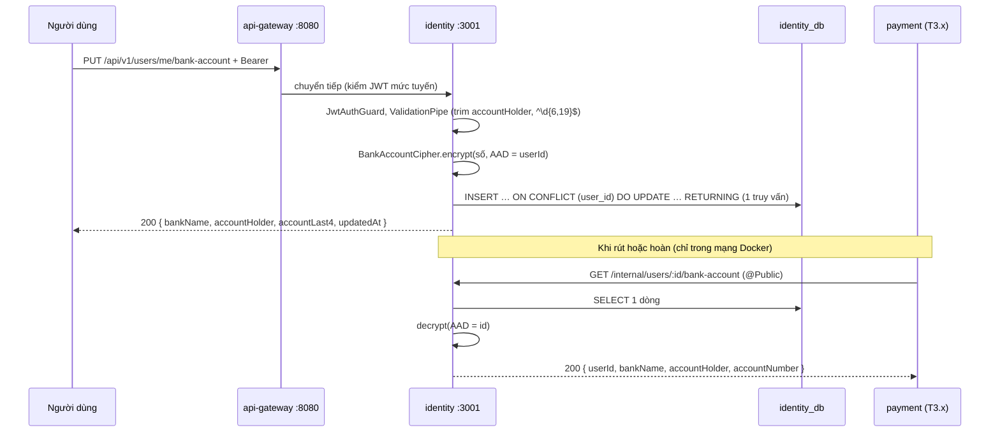

# Giải thích code — identity

> Viết khi task có code đã PASS test và lệnh kiểm chứng, trước `code-review` và commit (`CLAUDE.md` gốc §8).
> Đọc khi: cần hiểu code của identity để sửa tiếp (T2.5: OTP, quên mật khẩu, Google, khóa tài khoản, số điện thoại), review, hoặc chuẩn bị vấn đáp.

| | |
|---|---|
| **Chủ sở hữu / Cập nhật** | hoang.lv — 2026-11-19 |
| **Thành phần** | `services/identity/` (cổng 3001); phần chép từ `services/_template-nest/` ghi rõ ở §3 |
| **Task** | `T2.1` (`implementation/PHASE-2.md`); phần đã có từ trước (đăng ký, đăng nhập, làm mới, `/me`, seed ADMIN) giải thích ở §1, §3 để đủ bức tranh |
| **Thiết kế** | `design/IDENTITY/RE.IDENTITY/` (v2.1), `design/SHARED/RE.SERVICE_TEMPLATE/` (v1.3), `design/PAYMENT/RE.PAYOUT/` (v1.2, chỉ một `[cần xác nhận]`) |
| **Commit / PR** | Chưa commit; nhánh `feature/T2.1-identity-bank-account`; PR chưa mở |

## 1. Luồng chung

Identity giữ tài khoản, phiên và tài khoản nhận tiền. Client gọi qua gateway (8080): `auth/*` công khai, `users/me/bank-account` cần JWT, `admin/users` cần `ADMIN` (gateway chặn thô, `RolesGuard` ở identity kiểm lại). Payment lấy tài khoản nhận tiền qua API nội bộ `/internal/users/:id/bank-account`, chỉ gọi được trong mạng Docker (gateway trả 404 cho `/internal/*`).

T2.1 thêm ba nhóm: (1) tài khoản nhận tiền, số tài khoản **mã hóa AES-256-GCM** khi lưu và chỉ trả đầy đủ cho payment; (2) danh sách người dùng cho quản trị viên; (3) `revokeAllForUser` trong store refresh token (T2.5 dùng khi khóa tài khoản, đặt lại mật khẩu).



## 2. Cây thư mục

```text
services/identity/
├─ src/
│  ├─ main.ts, app.module.ts, app.setup.ts, swagger.setup.ts
│  ├─ config/                  # env.bootstrap, env.validation, feature-flags, service-info, config.module
│  ├─ common/                  # CHÉP từ _template-nest: auth/ errors/ http/ idempotency/ logging/ response/ lifecycle/
│  │  ├─ errors/uuid-param.pipe.ts (+ spec)        # T2.1, thêm ở template rồi chép
│  │  └─ response/page-query.dto.ts (+ spec)       # T2.1, thêm ở template rồi chép
│  ├─ database/                # data-source, database.module/health, transformers, migrations/ (4 file)
│  ├─ messaging/ redis/ storage/ health/           # CHÉP từ template (storage không bật)
│  ├─ identity/                # PHẦN RIÊNG CỦA IDENTITY
│  │  ├─ identity.module.ts
│  │  ├─ config/identity.env.ts (+ spec)
│  │  ├─ controllers/          # auth, bank-account, users.admin, users.internal
│  │  ├─ services/             # auth, password, token, bank-account, bank-account.cipher, user-admin (+ spec)
│  │  ├─ stores/               # refresh-token.store (interface), redis-refresh-token.store
│  │  ├─ entities/             # user, user-identity, bank-account
│  │  ├─ dto/                  # register, login, refresh, auth-tokens, user, bank-account, upsert-bank-account, list-users.query
│  │  ├─ errors/identity.errors.ts
│  │  └─ seed/seed-admin.ts (+ spec)
│  └─ scripts/                 # seed-admin.ts, export-openapi.ts
├─ test/                       # e2e (chép từ template), *.infra-spec.ts (Postgres, Redis, RabbitMQ thật), helpers/
├─ scripts/ensure-env.mjs
├─ Dockerfile, Dockerfile.dockerignore, nest-cli.json, tsconfig*.json, package.json
└─ .env.example, README.md
```

## 3. Chức năng từng file

### 3.1 Phần riêng của identity (`src/identity/`)

| File | Làm gì | Gọi tới / được gọi bởi | Ghi chú |
|---|---|---|---|
| `identity.module.ts` | Khai báo entity, controller, provider; tạo `RedisRefreshTokenStore` và `BankAccountCipher` bằng factory từ config | `app.module.ts` (chỉ nạp khi `isIdentityEnabled()`) | Cipher đọc `BANK_ACCOUNT_ENCRYPTION_KEY` qua `parseEncryptionKey`; thiếu khóa thì lỗi ngay lúc dựng module |
| `config/identity.env.ts` | Biến bắt buộc riêng của identity (DB, Redis, RabbitMQ, JWT, **khóa mã hóa**) | `config/env.bootstrap.ts` lúc khởi động | Khóa kiểm bằng `parseEncryptionKey`, lỗi không in giá trị khóa, in lệnh sinh khóa |
| `controllers/auth.controller.ts` | `register`, `login`, `refresh`, `logout`, `me` | `AuthService` | Đã có từ trước. Route công khai gắn `@Public()` |
| `controllers/bank-account.controller.ts` | Route 6, 7: `GET`, `PUT /users/me/bank-account` | `BankAccountService` | Không `@Public()`; người gọi là `@CurrentUser('sub')`, không nhận `userId` |
| `controllers/users.admin.controller.ts` | Route 8: `GET /admin/users` | `UserAdminService.list` | `@Roles('ADMIN')`; T2.5 thêm khóa, mở khóa vào đây |
| `controllers/users.internal.controller.ts` | `GET /internal/users/:id/bank-account` | `BankAccountService.getForPayout` | `@Public()` (tin mạng Docker), `@ApiExcludeController`, `:id` qua `createUuidParamPipe` |
| `services/auth.service.ts` | Đăng ký (transaction user + outbox `identity.registered`), đăng nhập, `issueSession`, `refresh`, `logout`, `me` | Store, `TokenService`, `PasswordService`, `OutboxService` | Đã có từ trước |
| `services/password.service.ts` | Băm, kiểm argon2id; `verifyDummy` chống dò email bằng độ trễ | `AuthService`, `seed-admin` | Đã có |
| `services/token.service.ts` | Ký access token RS256, sinh refresh token ngẫu nhiên | `AuthService` | Đã có |
| `services/bank-account.cipher.ts` | `encrypt`/`decrypt` AES-256-GCM, `parseEncryptionKey` | `BankAccountService`, `identity.env.ts` | Chỉ identity dùng, không đưa vào template |
| `services/bank-account.service.ts` | `upsertMine` (một câu `INSERT … ON CONFLICT`), `getMine`, `getForPayout` | Controller bank-account, controller nội bộ | Raw SQL cho upsert; `getMine` không đọc cột mã hóa |
| `services/user-admin.service.ts` | `list(query)` bằng `findAndCount` | `UsersAdminController` | Chỉ select 5 cột của `UserDto` |
| `stores/refresh-token.store.ts` | Interface store + token DI | `AuthService` | Thêm `revokeAllForUser` |
| `stores/redis-refresh-token.store.ts` | Cài đặt Redis, hai script Lua: `ROTATE_LUA` (xoay vòng, `SADD`, gia hạn), `REVOKE_ALL_LUA` | Provider ở module | Key: `rt:`, `revoked:`, `user-families:` (`Component_Class_Design §3`) |
| `entities/user.entity.ts`, `user-identity.entity.ts` | Bảng `users`, `user_identities` | TypeORM | Đã có |
| `entities/bank-account.entity.ts` | Bảng `bank_accounts` | `BankAccountService.getMine`, `getForPayout` | Cột mã hóa là `bytea` ↔ `Buffer` |
| `dto/upsert-bank-account.dto.ts` | Body route 7: `bankName` 2–100, `accountNumber` `^\d{6,19}$` (chuỗi), `accountHolder` cắt khoảng trắng rồi 1–200 | `BankAccountController` | Dùng lại `trim` của `register.dto.ts` |
| `dto/bank-account.dto.ts` | Response route 6–7, `from()` dựng từng trường | Service | Không bao giờ có số đầy đủ |
| `dto/list-users.query.ts` | Query route 8: kế thừa `PageQueryDto`, thêm `role?` | Controller admin, service | `@IsIn(USER_ROLES)` |
| `dto/register.dto.ts`, `login.dto.ts`, `refresh.dto.ts`, `auth-tokens.dto.ts`, `user.dto.ts` | DTO của auth, `UserDto.from` | | Đã có; `register.dto.ts` export thêm `trim` |
| `errors/identity.errors.ts` | Mã lỗi `IDENTITY_*` và hàm dựng `AppException` | Service | T2.1 thêm `IDENTITY_BANK_ACCOUNT_NOT_FOUND` |
| `seed/seed-admin.ts` | Tạo ADMIN idempotent, không tự nâng quyền | `scripts/seed-admin.ts` | Đã có |

### 3.2 Cấu hình, database, script

| File | Làm gì | Ghi chú |
|---|---|---|
| `src/config/env.bootstrap.ts` | Nạp `.env`, validate, thoát mã 1 nếu thiếu biến | Import đầu tiên của `main.ts`; bỏ qua phần riêng của identity khi `NODE_ENV=test` |
| `src/config/env.validation.ts` | Joi cho biến chung; T2.1 thêm `BANK_ACCOUNT_ENCRYPTION_KEY` (tùy chọn ở đây, bắt buộc ở `identity.env.ts`) | |
| `src/config/feature-flags.ts`, `service-info.ts`, `config.module.ts` | Bật module tùy chọn theo env, thông tin service, nạp `ConfigModule` | Chép từ template |
| `src/database/migrations/1730000000001-create-messaging-tables.ts` | `outbox_events`, `processed_events` | Từ template |
| `src/database/migrations/1731000000000-create-identity-tables.ts` | `users`, `user_identities` | Đã có |
| `src/database/migrations/1732000000000-create-bank-accounts.ts` | Bảng `bank_accounts` (PK, `UQ_bank_accounts_user`, `FK_bank_accounts_user`) | T2.1 |
| `src/database/migrations/1732000000001-add-users-list-indexes.ts` | Hai index cho `GET /admin/users` | T2.1; không sửa migration cũ |
| `src/database/data-source.ts`, `database.module.ts`, `database.health.ts`, `transformers.ts` | DataSource cho CLI, module DB, health, transformer cột | Từ template |
| `src/scripts/seed-admin.ts`, `export-openapi.ts`, `scripts/ensure-env.mjs` | Script `pnpm seed:admin`, xuất OpenAPI, tạo `.env` khi `pnpm dev` | |
| `Dockerfile`, `Dockerfile.dockerignore` | Ảnh 3 stage | Không đổi ở T2.1; khóa mã hóa truyền qua env của compose |
| `.env.example`, `README.md` | Mẫu biến (khóa để trống kèm lệnh sinh), bảng biến | T2.1 thêm `BANK_ACCOUNT_ENCRYPTION_KEY` |
| `infra/compose/docker-compose.yml` (service `identity`) | `BANK_ACCOUNT_ENCRYPTION_KEY: ${BANK_ACCOUNT_ENCRYPTION_KEY:-}` | Để trống thì chính identity báo thiếu rồi dừng |

### 3.3 Phần chép từ template (không giải thích lại)

`src/common/*`, `src/messaging/*`, `src/redis/*`, `src/storage/*`, `src/health/*`, `src/app.*`, `src/main.ts`: xem `services/_template-nest/README.md §3` và `design/SHARED/RE.SERVICE_TEMPLATE/`. Riêng T2.1 thêm vào template rồi chép sang: `PageQueryDto`, `createUuidParamPipe`, `expectResponseMatchesOpenApi` (`test/helpers/contracts.ts`) và devDependency `yaml@2.9.1` (ADR-0014).

### 3.4 Test (`test/`, `src/**/*.spec.ts`)

| File | Tầng | Kiểm gì |
|---|---|---|
| `src/identity/services/bank-account.cipher.spec.ts` | unit | Khứ hồi, IV ngẫu nhiên, sai AAD/khóa, sửa 1 byte `iv`/`tag`/`ciphertext`, dữ liệu ngắn, lỗi không chứa số, `parseEncryptionKey` |
| `src/identity/services/bank-account.service.spec.ts` | unit | SQL upsert có `updated_at = now()`, tham số mã hóa (không số rõ), response từng trường, 404, giải mã hỏng |
| `src/identity/dto/upsert-bank-account.dto.spec.ts`, `list-users.query.spec.ts` | unit | Luật DTO (trim, 6–19 chữ số, role, pageSize) |
| `src/identity/services/user-admin.service.spec.ts` | unit | Tham số `findAndCount`, không select `passwordHash`, trang vượt |
| `src/identity/config/identity.env.spec.ts`, `src/config/env.bootstrap.spec.ts` | unit | Khóa thiếu/sai/đúng; tiến trình thật thoát mã 1 và không in khóa |
| `src/common/errors/uuid-param.pipe.spec.ts`, `src/common/response/page-query.dto.spec.ts` | unit | Chép từ template |
| `src/identity/services/auth.service.spec.ts`, `password`, `token`, `seed-admin` `.spec.ts` | unit | Đã có; `FakeStore` thêm `revokeAllForUser` |
| `test/refresh-token.store.infra-spec.ts` | infra (Redis) | Lua xoay vòng, `revokeAllForUser` (hai họ, user khác, phiên cũ, TTL set) |
| `test/bank-account.infra-spec.ts` | infra | Route 6–7: 401, 404, DB chỉ có bytea, ghi đè tăng `updatedAt`, log không có số, 1 truy vấn |
| `test/internal-users.infra-spec.ts` | infra | API nội bộ: đúng 4 trường, khớp `identity-internal.v1.yaml` (200, 400, 404), bản mã hỏng → 500 |
| `test/admin-users.infra-spec.ts` | infra | Route 8: quyền, thứ tự, phân trang, lọc role, ≤ 2 truy vấn, `EXPLAIN` dùng index |
| `test/auth.infra-spec.ts`, `seed-admin.infra-spec.ts`, `messaging.infra-spec.ts` | infra | Đã có |
| `test/contracts-helper.e2e-spec.ts`, `test/helpers/contracts.ts` | e2e | Chép từ template: `expectEventMatchesContract`, `expectResponseMatchesOpenApi` |
| `test/setup-infra-env.ts` | cấu hình | Khóa cố định chỉ cho test |

## 4. Quyết định không hiển nhiên

| Quyết định | Lý do | Phương án đã loại | Căn cứ |
|---|---|---|---|
| AAD = `userId` khi mã hóa | Dòng `bank_accounts` của A bị chép sang B (lỗi code hoặc kẻ có quyền ghi DB) thì giải mã thất bại thay vì lộ tài khoản của A cho B | Không dùng AAD (đổi chỗ dòng không bị phát hiện) | `API_Spec §1.4` |
| Định dạng `iv(12) ‖ authTag(16) ‖ ciphertext`, IV ngẫu nhiên mỗi lần ghi | Một cột `bytea`, không cần cột phụ; IV 12 byte là chuẩn của GCM; IV trùng với cùng khóa là thảm họa nên ngẫu nhiên | Hai cột (iv, data); IV theo bộ đếm | `API_Spec §1.4`, §6 |
| Giải mã lỗi → `500 INTERNAL_ERROR` chung chung, log không kèm số | Dữ liệu hỏng hoặc khóa sai là lỗi hệ thống, không phải lỗi người dùng; không lộ chi tiết | Trả 4xx; trả message của crypto | `security-policy §5` |
| `PUT` bằng một câu `INSERT … ON CONFLICT … RETURNING`, `updated_at = now()` viết rõ | Nguyên tử: hai `PUT` đồng thời không lỗi trùng khóa, vẫn một dòng; `DEFAULT now()` chỉ chạy lúc `INSERT` nên ghi đè phải đặt tay | `SELECT` rồi `INSERT`/`UPDATE` (hai request cùng lúc đều thấy "chưa có"); `repository.save` | `API_Spec §1.4`, `NFR01` |
| Response dựng từng trường (`BankAccountDto.from`), không trả entity | Thêm cột vào entity không tự lộ ra API; entity có cột mã hóa | Trả thẳng entity rồi `@Exclude` | `security-policy §5` |
| `accountNumber` là chuỗi, `^\d{6,19}$` | Số 0 đầu và số 19 chữ số vượt độ chính xác của `number` | Nhận `number` | Quyết định 2026-11-16 |
| Body nội bộ đúng 4 trường (không `updatedAt`, `accountLast4`) | Schema `BankAccount` có `additionalProperties: false`; payment dựa vào hợp đồng | Dùng chung `BankAccountDto` | `contracts/openapi/identity-internal.v1.yaml`, ADR-0012 |
| `expectResponseMatchesOpenApi` kiểm body thật với hợp đồng | `contracts:check` chỉ kiểm `example` trong file khớp schema, không kiểm code thật có trả đúng | Tin vào ví dụ | `CLAUDE.md §8` (DoD T2.1) |
| `revokeAllForUser` dùng set `user-families:<userId>` | Thu hồi theo user cần biết user có những họ nào; set đọc một lần | `SCAN` toàn bộ key `rt:*` (chậm, tăng theo dữ liệu); lưu danh sách họ trong Postgres | `Component_Class_Design §2–3` |
| Cả thu hồi và đọc-set-rồi-đặt-cờ nằm trong **một script Lua** | Nguyên tử: không có `create` chen giữa lúc đọc set và xóa set | Nhiều lệnh từ Node | `Component_Class_Design §2` |
| `ROTATE_LUA` làm `SADD familyId` rồi `EXPIRE` set | (1) Gia hạn: họ xoay vòng ngày thứ 6 sống tới ngày 13, set hết hạn ngày 7 thì thu hồi sót. (2) `SADD`: phiên tạo trước thay đổi tự vào set ở lần refresh kế tiếp | Chỉ `EXPIRE` (phiên cũ không bao giờ vào set); migration quét Redis để nạp set | A chốt 2026-11-19; `Component_Class_Design §2` |
| `GET /admin/users`: **tối đa 2** truy vấn, `findAndCount` | TypeORM bỏ `COUNT` khi trang đầu chưa đầy (`OFFSET 0`, ít dòng hơn `LIMIT`) vì `total` chính là số dòng nhận được; vẫn đúng, trong ngưỡng 4 | Tự `find` + `count` luôn 2 truy vấn | `non-functional-standards §1`; A chốt "giữ nguyên" 2026-11-19 |
| Hai index `(created_at DESC, id DESC)` và `(role, created_at DESC, id DESC)` | Chuẩn: MUST có index cho cột sắp xếp, lọc. Khớp thứ tự nên `EXPLAIN` không có bước Sort | Không index (bảng nhỏ) | `non-functional-standards §1`, `API_Spec §6` |
| `createUuidParamPipe` thay `new ParseUUIDPipe()` cho API nội bộ | `ParseUUIDPipe` trần trả `BAD_REQUEST`; cả bốn hợp đồng nội bộ khai `VALIDATION_FAILED` + "<tên> phải là UUID". Route công khai của template giữ nguyên (có test, code đã merge) | Sửa `ParseUUIDPipe` cho mọi route (đổi hành vi đã merge) | C19 ở `van-de-can-quyet-dinh.md` |
| `PageQueryDto` ở template, chép sang identity | listing, rental, payment, notification đều cần; ngưỡng 20/50 ở một nơi | Viết riêng ở identity | ADR-0014 |
| `BANK_ACCOUNT_ENCRYPTION_KEY` bắt buộc ở `identity.env.ts` nhưng compose dùng `${…:-}` | Thiếu thì identity tự báo rõ rồi dừng; `:?` sẽ làm hỏng cả `infra:up` của người chưa thêm biến | `:?` trong compose | `API_Spec §5` |
| Không có route đổi vai trò | Vai trò cố định từ lúc tạo; muốn vai trò khác thì email mới | Route 9 | A chốt 2026-11-18 |

## 5. Câu hỏi vấn đáp

| Câu hỏi | Trả lời ngắn | Xem thêm |
|---|---|---|
| Vì sao mã hóa số tài khoản mà không chỉ băm? | Payment cần số **đầy đủ** để quản trị viên chuyển khoản; băm một chiều không lấy lại được. Mã hóa đối xứng cho phép giải mã, nhưng chỉ identity có khóa | §4 |
| AAD để làm gì? | Gắn bản mã với `userId`. Chép dòng của người này sang người khác thì xác thực GCM thất bại | `bank-account.cipher.spec.ts` |
| Mất khóa thì sao? | Mọi số tài khoản đã lưu không giải mã được (500). Không xoay khóa; người dùng phải khai lại. Hướng: đánh số phiên bản khóa trong dữ liệu | `security-policy §6` |
| Hai `PUT` cùng lúc thì sao? | Một câu `ON CONFLICT DO UPDATE` nguyên tử: cả hai 200, vẫn một dòng; bản ghi sau thắng | `bank-account.infra-spec.ts` |
| Làm sao biết số tài khoản không lộ qua log? | Access log chỉ ghi method, url, status; body không được log; lỗi validate không echo giá trị; test kiểm log của PUT thành công, bị 400, và của 500 mã hỏng | `bank-account.infra-spec.ts`, `internal-users.infra-spec.ts` |
| Khóa tài khoản làm sao thu hồi mọi phiên? | `revokeAllForUser` đọc set họ của user, đặt cờ `revoked:<familyId>` từng họ, xóa set, trong một script Lua | `refresh-token.store.infra-spec.ts` |
| Vì sao `rotate` phải `SADD`? | Phiên cũ chưa có trong set thì khóa tài khoản không thu hồi được; sau lần refresh đầu tiên nó tự vào set | §4 |
| Phiên chưa bao giờ refresh thì sao? | Không thu hồi được tới khi hết hạn (tối đa 7 ngày); access token còn tối đa 15 phút. Hệ thống chưa chạy thật nên chấp nhận | §6 |
| Vì sao `/internal` không cần JWT? | Gateway trả 404 cho `/internal/*` từ ngoài, cổng service không publish; tin mạng Docker. Hướng: xác thực service-to-service hoặc mTLS | `security-policy §2, §6` |
| Vì sao danh sách người dùng có khóa phụ `id`? | Nhiều người có thể cùng `created_at`; thiếu khóa phụ thì phân trang lặp hoặc sót dòng | `admin-users.infra-spec.ts` |
| Vì sao test dùng `EXPLAIN` với `enable_seqscan=off`? | Bảng test chỉ vài dòng nên planner chọn quét tuần tự; tắt `seqscan` để chứng minh index **dùng được** và khớp thứ tự (không Sort) | `admin-users.infra-spec.ts` |
| Vì sao có hai cách báo `id` sai? | Route công khai của template giữ `BAD_REQUEST` (code đã merge, có test); API nội bộ theo hợp đồng `VALIDATION_FAILED`. Chờ A chốt thống nhất | C19 |
| Contract-first nghĩa là gì ở đây? | `identity-internal.v1.yaml` viết trước; test `expectResponseMatchesOpenApi` kiểm body **thật** khớp, bắt cả trường thừa | ADR-0012 |

## 6. Hạn chế đã biết

| Hạn chế | Ảnh hưởng | Hướng xử lý |
|---|---|---|
| Không xoay khóa mã hóa | Lộ khóa hoặc mất khóa: không đổi khóa mà giữ dữ liệu cũ được | Đánh số phiên bản khóa trong `bytea` (`security-policy §6`); ghi `tech-debt.md` |
| Phiên tạo trước thay đổi `user-families` chưa refresh thì `revokeAllForUser` không thu hồi được | Tối đa 7 ngày (hệ thống chưa chạy thật) | Tự vào set khi refresh; không cần xử lý thêm (`security-policy §6`) |
| Hai cách báo `id` sai (C19) | Client phải xử lý hai mã (`BAD_REQUEST`, `VALIDATION_FAILED`) tùy route | A chốt; đề xuất thống nhất `VALIDATION_FAILED` |
| `/internal/*` tin mạng Docker | Ai vào được mạng Docker đọc được số tài khoản đầy đủ | Xác thực service-to-service hoặc mTLS (`security-policy §6`) |
| Người dùng không còn trong DB nhưng token còn hạn → `PUT` lỗi khóa ngoại → 500 | Hiện chưa có API xóa người dùng nên chưa xảy ra | Map lỗi `23503` sang `IDENTITY_USER_NOT_FOUND` khi có xóa/khóa (T2.5); ghi `tech-debt.md` |
| `findAndCount` có thể trả `total` tính từ trang đầu khi trang chưa đầy | Không sai; đồng thời có người đăng ký giữa hai truy vấn thì `total` lệch tạm thời | Chấp nhận |
| `expectResponseMatchesOpenApi` chép logic `rewriteRefs` của `check-openapi.mjs` | Hai nơi phải sửa cùng lúc nếu đổi cách nạp schema | Script ESM không import được từ test TS; gộp khi có chỗ đặt chung (ghi `tech-debt.md`) |
| DB dev có user `t21-*` do smoke test | Không ảnh hưởng | Xóa khi dọn dev DB |
