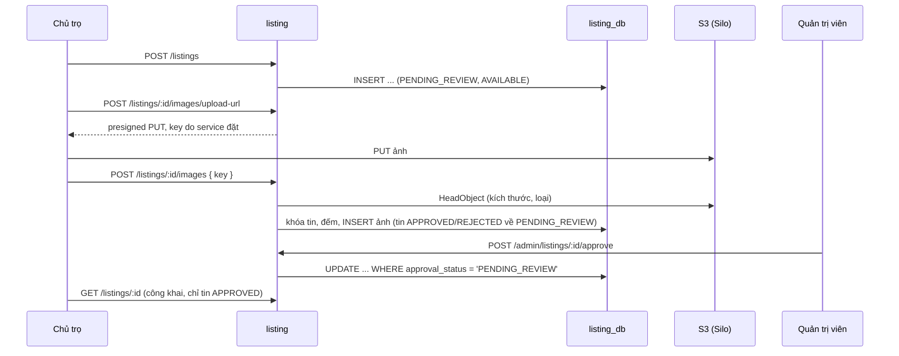

# Giải thích code — Listing (`services/listing`)

> Đọc khi: cần hiểu code listing để sửa tiếp (T2.3 thêm tìm kiếm, giữ chỗ), review, hoặc chuẩn bị vấn đáp.

| | |
|---|---|
| **Chủ sở hữu / Cập nhật** | hoang.lv — 2026-11-20 |
| **Thành phần** | `services/listing/` (cổng 3002, `listing_db` PostGIS, bucket `listing-images`) |
| **Task** | T2.2 (`implementation/PHASE-2.md`). T2.3 thêm tìm kiếm PostGIS, `/internal/*`, giữ chỗ |
| **Thiết kế** | `design/LISTING/RE.LISTING/` v1.2, ADR-0010; `design/SHARED/RE.SERVICE_TEMPLATE/` v2.1 |
| **Commit / PR** | chưa có (nhánh `feature/T2.2-listing-crud`) |

## 1. Luồng chung

Chủ trọ gọi gateway (8080) với JWT. Gateway kiểm chữ ký và vai trò thô theo `routes.ts`, rồi chuyển cho listing. Listing kiểm lại JWT bằng khóa công khai (`JwtAuthGuard`, `@Roles`), kiểm **chủ sở hữu** bằng `sub` (không bao giờ từ body, BR-03), rồi ghi bằng **một câu SQL có điều kiện**. Ảnh đi thẳng từ trình duyệt lên S3 bằng presigned PUT; listing chỉ cấp URL và kiểm lại bằng `HeadObject`. Sản phẩm và tin đăng là một bản ghi `listings` (ADR-0010). Listing không phát và không nghe sự kiện, không gọi service khác.



## 2. Cây thư mục

```text
services/listing/
├─ src/
│  ├─ app.module.ts, app.setup.ts, main.ts, swagger.setup.ts   # chép từ template, app.module nạp ListingModule
│  ├─ common/ config/ health/ database/ storage/ messaging/ redis/   # chép nguyên từ template (ADR-0014)
│  ├─ config/ (env.validation, env.bootstrap, feature-flags)    # thêm LISTING_IMAGE_*, isListingEnabled()
│  ├─ database/migrations/1733000000000-create-listings.ts
│  └─ listing/
│     ├─ listing.module.ts
│     ├─ config/listing.env.ts (+ spec)
│     ├─ controllers/ listings, listings.admin
│     ├─ services/ listing-command, listing-review, listing-image, listing-query, listing.presenter,
│     │            listing-edit.rules, listing-image.rules, listing.sql
│     ├─ dto/ entities/ errors/
├─ test/ (template + listing-crud.infra-spec.ts)
├─ Dockerfile, package.json, .env.example
```

## 3. Chức năng từng file

Phần chép nguyên từ `_template-nest` (`common/`, `health/`, `redis/`, `messaging/`, `Dockerfile`, `test/*` còn lại) xem `RE.SERVICE_TEMPLATE`, không lặp ở đây. Riêng `src/storage/storage.service.ts` là bản template v2.1 (có `headObject`).

| File | Làm gì | Gọi tới / được gọi bởi | Ghi chú |
|---|---|---|---|
| `src/app.module.ts` | Nạp `ListingModule` khi đủ DB + S3 | `feature-flags.ts#isListingEnabled` | Bỏ `ExampleModule` |
| `src/config/env.validation.ts` | Thêm `LISTING_IMAGE_MAX_BYTES` (5 MB), `LISTING_IMAGE_MAX_COUNT` (10), `LISTING_IMAGE_TYPES` | `ListingImageService` | Mặc định theo `API_Spec §5` |
| `src/config/env.bootstrap.ts` | Gọi `checkListingEnv` khi khởi động (bỏ qua `NODE_ENV=test`) | `main.ts` | Giống cách identity gắn `identity.env.ts` |
| `src/config/feature-flags.ts` | `isListingEnabled()` = DB + S3 | `app.module.ts` | Không cần Redis, RabbitMQ |
| `src/listing/config/listing.env.ts` | Biến bắt buộc: DB, S3, `S3_BUCKETS` có `listing-images`, JWT public key + issuer | `env.bootstrap.ts` | Không in giá trị biến sai |
| `src/database/migrations/1733000000000-create-listings.ts` | `listings`, `listing_images`, CHECK, GiST `ix_listings_location`, `ix_listing_images_listing` | `pnpm migration:run` | Không `CREATE EXTENSION` (`listing_user` không phải superuser; init script đã bật) |
| `src/listing/entities/listing.enums.ts` | Hằng `PROPERTY_TYPES`, `LISTING_STATUSES`, `APPROVAL_STATUSES`, 11 `AMENITIES` | DTO, entity | Một nguồn cho DTO và CHECK |
| `src/listing/entities/listing.entity.ts`, `listing-image.entity.ts` | Khai báo cột (`location` là `geography`, `select: false`) | `TypeOrmModule.forFeature` | Truy vấn dùng SQL, không dùng repository |
| `src/listing/errors/listing.errors.ts` | 8 mã `LISTING_*` và hàm dựng `AppException` | Các service | Khớp `API_Spec §4` |
| `src/listing/dto/*.dto.ts`, `list-mine.query.ts`, `trim.ts` | Validate body, query, hình dạng response | Controller | `UpdateListingDto = PartialType(Create)`, `lat`/`lng` đi cùng nhau |
| `src/listing/services/listing.sql.ts` | `listingColumns(alias)`, `pointSql`, `rowsOf`, `isUniqueViolation` | Mọi service | `rowsOf`: TypeORM trả `[dòng, số dòng]` cho `UPDATE ... RETURNING` |
| `src/listing/services/listing.presenter.ts` | `ListingRow` → `ListingDto`, một truy vấn ảnh cho cả trang, presign GET | Command, Review, Query, Image | Không truy vấn trong vòng lặp |
| `src/listing/services/listing-edit.rules.ts` | Hàm thuần: `classifyEdit`, `resubmits` (bảng duyệt lại §1.1) | `ListingCommandService` | Có spec |
| `src/listing/services/listing-image.rules.ts` | Hàm thuần: `buildImageKey`, `isKeyOfListing`, `checkUploadedImage` | `ListingImageService` | Có spec |
| `src/listing/services/listing-command.service.ts` | `create`, `update`, `hide`, `unhide`, `softDelete` | `ListingsController` | `UPDATE ... WHERE <trạng thái mong đợi>`; 0 dòng thì đọc lại chọn 404/403/409 |
| `src/listing/services/listing-review.service.ts` | `approve`, `reject` | `ListingsAdminController` | `WHERE approval_status = 'PENDING_REVIEW'` |
| `src/listing/services/listing-image.service.ts` | `createUploadUrl`, `confirm` | `ListingsController` | `HeadObject` ngoài transaction; khóa dòng rồi mới đếm |
| `src/listing/services/listing-query.service.ts` | `findPublic` (route 12), `findMine` (route 6) | `ListingsController` | T2.3 thêm `search`, `snapshot` |
| `src/listing/controllers/listings.controller.ts` | Route 1–8, 12 và `mine` | | `mine` khai báo trước `:id`; `confirmImage` đặt `201` hoặc `200` bằng `@Res({ passthrough })` |
| `src/listing/controllers/listings.admin.controller.ts` | Route 9–10, `@Roles('ADMIN')` | | |
| `src/listing/listing.module.ts` | Ghép controller, service | `app.module.ts` | |
| `test/setup-infra-env.ts` | Dùng `listing_db`, schema test, `search_path` có `public` | `jest-infra.json` | Cần `public` để thấy kiểu `geography` |
| `test/listing-crud.infra-spec.ts` | 38 ca với Postgres + S3 thật: test 1, 2, 3, 12–17, số truy vấn | `pnpm test:infra` | |
| `.env.example`, `Dockerfile` | Cấu hình dev, ảnh Docker | | |
| `infra/compose/docker-compose.yml` (khối `listing`) | Service `re-listing`, không publish cổng | gateway gọi `http://listing:3002` | Chạy kèm `--profile dev` (cần `s3`, `postgres`) |

## 4. Quyết định không hiển nhiên

| Quyết định | Lý do | Phương án đã loại | Căn cứ |
|---|---|---|---|
| Ghi trạng thái bằng một câu `UPDATE ... WHERE` | Hai request đồng thời: một bên thắng, không có cửa sổ kiểm tra-rồi-ghi. `hide` dùng cùng điều kiện `status = 'AVAILABLE'` với giữ chỗ nên không đè lên đơn | Đọc rồi ghi, khóa ứng dụng | ADR-0010, BR-06, `Processing_Flow §3–4` |
| Khóa dòng tin (`FOR UPDATE`) rồi **đếm ảnh bằng câu riêng** | Ở READ COMMITTED, subquery đếm trong cùng câu `FOR UPDATE` dùng snapshot cũ: hai request cùng thấy 9 ảnh và cùng thêm. Test 16 bắt được lỗi này | Đếm bằng subquery cùng câu; `UNIQUE` trên `(listing_id, sort_order)` | `RE.LISTING §1.2` mục 8 |
| `PATCH` đọc dòng bằng `FOR UPDATE` trong transaction ngắn | Quyết định "về `PENDING_REVIEW`" dựa trên trạng thái duyệt hiện tại; quản trị viên không chen vào giữa | CASE trong SQL lặp điều kiện nhiều lần | `API_Spec §1.1` |
| `HeadObject` gọi ngoài transaction | Không giữ transaction khi gọi mạng | Gọi trong transaction | `coding-convention §4` |
| Ảnh không hợp lệ thì `deleteObject`, lỗi xóa chỉ log | Không để rác trên S3; kết quả `400` không phụ thuộc việc dọn | Bỏ qua | A chốt 2026-11-19 |
| Ảnh lấy URL mà không xác nhận không được dọn | Ghi nợ, phạm vi đồ án | Job quét S3 | `tech-debt.md` #14 |
| Xác nhận lại cùng key → `200` kèm ảnh đã có | Idempotent, kể cả đua hai lời gọi (bắt `23505`) | `409` | A chốt 2026-11-19 |
| Key ảnh do service sinh, route 8 kiểm dạng `listings/{id}/{uuid}.{ext}` | Client không đặt key, không dùng key của tin khác hay `..` | Tin client | `security-policy §5` |
| Dùng SQL thuần, entity chỉ khai báo cột | PostGIS (`ST_Y`, `ST_SetSRID`), `RETURNING`, `FOR UPDATE OF` | QueryBuilder, repository | T2.3 tiếp tục `ST_DWithin` |
| `rowsOf` bọc mọi `UPDATE ... RETURNING` | TypeORM + Postgres trả `[dòng, số]` cho UPDATE/DELETE, mảng dòng cho SELECT/INSERT | Đoán kiểu ở từng chỗ | Lỗi 500 phát hiện ở infra test |
| Bản chép template còn `src/messaging`, migration messaging | ADR-0014: không sửa riêng bản chép | Xóa phần thừa | `tech-debt.md` #15 |

## 5. Câu hỏi vấn đáp

| Câu hỏi | Trả lời ngắn | Xem thêm |
|---|---|---|
| Hai chủ trọ cùng sửa/xóa tin của nhau thì sao? | `403 LISTING_NOT_OWNER`, kiểm bằng `sub` của JWT, không tin `ownerId` trong body | `API_Spec §1.2`, test 1 (T04) |
| Vì sao không xóa được tin đang có đơn cọc? | `UPDATE ... WHERE status NOT IN ('HELD','DEPOSITED')`; 0 dòng thì `409 LISTING_HAS_ACTIVE_DEPOSIT` | `Processing_Flow §4`, test 2 (T18) |
| Ảnh quá 5 MB bị chặn ở đâu? | Presigned PUT không giới hạn kích thước, nên `HeadObject` sau khi tải; quá cỡ thì `400` và xóa object | `gotchas.md`, test 12 |
| Sửa gì thì tin phải duyệt lại? | Nội dung hiển thị hoặc thêm ảnh: `APPROVED → PENDING_REVIEW`; tin `REJECTED` sửa gì cũng nộp lại; giá, cọc, diện tích, tiện ích thì giữ `APPROVED` | `API_Spec §1.1`, `listing-edit.rules.spec.ts` |
| Hai quản trị viên duyệt cùng lúc? | Một người thắng bằng `WHERE approval_status = 'PENDING_REVIEW'`, người kia `409 LISTING_ALREADY_REVIEWED` | Test 3 |
| Tin `HIDDEN` có xem được không? | Chi tiết công khai vẫn trả; chỉ tìm kiếm (T2.3) loại tin ẩn | `API_Spec §1.4` |
| Vì sao listing không có `clients/` hay outbox? | Không gọi và không phát sự kiện; rental gọi listing, không ngược lại | `architecture.md §7`, ADR-0004 |

## 6. Hạn chế đã biết

| Hạn chế | Ảnh hưởng | Hướng xử lý |
|---|---|---|
| Ảnh lấy upload-url nhưng không xác nhận nằm lại trên S3 | Tốn dung lượng | Job dọn hoặc lifecycle rule (`tech-debt.md` #14) |
| `listing_db` có bảng `outbox_events`, `processed_events` không dùng | Không ảnh hưởng | `tech-debt.md` #15 |
| Chưa có tìm kiếm, giữ chỗ, `/internal/*` | Rental chưa gọi được listing | T2.3 |
| `description` ≤ 5000 và trường bắt buộc khi tạo (`address`, `district`, `city`) là đề xuất | DDL cho phép `NULL` | `API_Spec §8` chờ A xác nhận |
| Ảnh quá giới hạn 10 khi xác nhận, ảnh hợp lệ nằm lại trên S3 | Như trên | Cùng tech-debt #14 |
