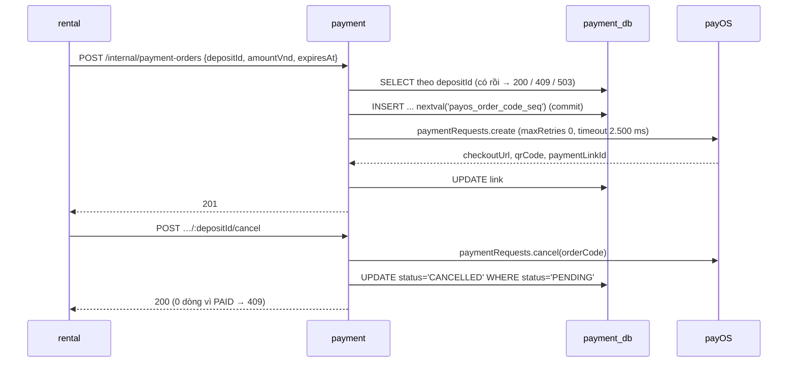

# Giải thích code — payment

> Đọc khi: cần hiểu code của payment để sửa tiếp (webhook T3.4, ví và payout T3.6), review, hoặc chuẩn bị vấn đáp.

| | |
|---|---|
| **Chủ sở hữu / Cập nhật** | hoang.lv — 2026-11-21 |
| **Thành phần** | `services/payment/` (cổng 3004); phần chép từ `services/_template-nest/` ghi rõ ở §3.3 |
| **Task** | `T3.1` (khung, payment order, payOS; `implementation/PHASE-3.md`) |
| **Thiết kế** | `design/PAYMENT/RE.PAYMENT/` (v1.2), `design/PAYMENT/RE.PAYOUT/API_Spec.md §7` (DDL ví), ADR-0009 |
| **Commit / PR** | Nhánh `feature/T3.1-payment-order` (Claude làm khi A vắng, 2026-11-21) |

## 1. Luồng chung

Rental tạo đơn đặt cọc xong thì gọi `POST /internal/payment-orders`. Payment **ghi order `PENDING` trước** (cấp `orderCode` từ sequence), rồi mới gọi payOS tạo link hết hạn đúng lúc giữ chỗ hết hạn, lưu link và trả `201`. Gọi lại cùng `depositId` trả order cũ (`200`). Khi giữ chỗ hết hạn hoặc bù trừ, rental gọi `…/cancel`: payment hủy link ở payOS **trước**, rồi `UPDATE … WHERE status='PENDING'`; nếu webhook (T3.4) đã kịp chuyển order sang `PAID` thì `UPDATE` đổi 0 dòng và payment trả `409`, rental không chuyển đơn sang `EXPIRED`. Không có transaction nào bao lời gọi payOS.



## 2. Cây thư mục

```text
services/payment/
├─ src/
│  ├─ app.module.ts                 # nạp PaymentModule khi có DATABASE_URL
│  ├─ config/                       # env.validation (+PAYOS_*), env.bootstrap (+checkPaymentEnv), feature-flags (+isPaymentEnabled)
│  ├─ database/migrations/          # 1730000000001 messaging (template), 1734000000000 bảng payment + ví
│  └─ payment/
│     ├─ payment.module.ts
│     ├─ config/payment.env.ts      # biến bắt buộc riêng (+ spec)
│     ├─ clients/payos.client.ts    # bọc @payos/node (+ spec)
│     ├─ controllers/payment-orders.internal.controller.ts
│     ├─ services/payment-order.service.ts (+ spec)
│     ├─ dto/payment-order.dto.ts (+ spec)
│     ├─ entities/payment-order.entity.ts
│     └─ errors/payment.errors.ts
├─ test/
│  ├─ payment-orders.infra-spec.ts  # test 7–10, hợp đồng, đếm truy vấn; payOS giả
│  ├─ setup-infra-env.ts            # payment_db + khóa payOS giả
│  └─ (e2e, messaging, storage của template)
├─ .env.example, Dockerfile, package.json, README.md
```

## 3. Chức năng từng file

### 3.1 Phần riêng của payment (`src/payment/`)

| File | Làm gì | Gọi tới / được gọi bởi | Ghi chú |
|---|---|---|---|
| `payment.module.ts` | Khai báo entity, controller; dựng SDK payOS (`new PayOS({...}).paymentRequests`), cấu hình `returnUrl`/`cancelUrl`, `PayosClient` bằng factory | `app.module.ts` (khi `isPaymentEnabled()`) | SDK: `timeout = PAYOS_TIMEOUT_MS`, `maxRetries: 2` (mặc định cho hủy), `logLevel: 'off'` |
| `config/payment.env.ts` | Biến bắt buộc: `DATABASE_URL`, 3 khóa `PAYOS_*`, `JWT_ISSUER`, khóa công khai JWT | `config/env.bootstrap.ts` lúc khởi động (bỏ qua khi `NODE_ENV=test`) | Không in giá trị biến; cùng cách với `listing.env.ts` |
| `clients/payos.client.ts` | `createLink` (`maxRetries: 0`, `description = DC<orderCode>`, `items[0].name = listingTitle`, `expiredAt` giây), `cancelLink(orderCode)` | `PaymentOrderService` | Mọi lỗi SDK → `503 PAYMENT_PROVIDER_UNAVAILABLE`; log `warn` chỉ có `op`, `orderCode`, tên lỗi, HTTP status, mã payOS |
| `services/payment-order.service.ts` | `create` (bảng §2a), `cancel` (§2b), `get` (§2c, chỉ đọc DB) | Controller nội bộ | INSERT dùng SQL thô để cấp `nextval` trong cùng câu; bắt `23505 uq_payment_orders_deposit` khi tạo song song |
| `controllers/payment-orders.internal.controller.ts` | 3 route `/internal/payment-orders*`; đặt `201`/`200` theo kết quả `create` | Rental (S2) | `@Public()` + `@ApiExcludeController()` như listing; `depositId` qua `createUuidParamPipe` |
| `dto/payment-order.dto.ts` | Body `CreatePaymentOrderDto` (UUID, `listingTitle` 1–200, `amountVnd` số nguyên ≥ 1, `expiresAt` có múi giờ); kiểu view khớp hợp đồng | Controller, service | Trường lạ bị từ chối (`forbidNonWhitelisted`, hợp đồng `additionalProperties: false`) |
| `entities/payment-order.entity.ts` | Bảng `payment_orders`; `PAYMENT_ORDER_STATUSES` | TypeORM | Tiền và `orderCode` là `bigint` → number qua `bigintToNumber` |
| `errors/payment.errors.ts` | 5 mã của `API_Spec §4`; `isUniqueViolation(err, constraint)` | Service, client | Hàm `23505` viết lại cục bộ (không import service khác) |

### 3.2 Cấu hình, database, triển khai

| File | Làm gì | Ghi chú |
|---|---|---|
| `src/database/migrations/1734000000000-create-payment-tables.ts` | Sequence `payos_order_code_seq` (START 100000); bảng `payment_orders`, `payos_webhook_events` (+ `ux_webhook_accepted_reference`), `late_payments` (`RE.PAYMENT §6`); `admin_wallet` (+ một dòng id 1, số dư 0), `wallet_transactions`, `refund_requests`, `withdrawal_requests`, `transfer_receipts`, `audit_log` (`RE.PAYOUT §7`) | Có `down`. Tên ràng buộc đặt rõ (`uq_payment_orders_deposit`, ...) để service nhận ra lỗi trùng |
| `src/config/env.validation.ts` | Thêm `PAYOS_CLIENT_ID/API_KEY/CHECKSUM_KEY` (tùy chọn ở schema chung), `PAYOS_RETURN_URL`, `PAYOS_CANCEL_URL` (http/https), `PAYOS_TIMEOUT_MS` (100–30.000, mặc định 2.500) | Ba khóa bắt buộc ở `payment.env.ts` |
| `src/config/env.bootstrap.ts`, `feature-flags.ts`, `app.module.ts` | Kiểm biến riêng lúc khởi động; `isPaymentEnabled = isDatabaseEnabled()`; nạp `PaymentModule` | `env.bootstrap.spec.ts` sửa như listing: test thiếu biến, đủ biến |
| `.env.example` (payment, gốc), `infra/compose/docker-compose.yml` | Biến `PAYOS_*`; service `payment` profile `apps`, không publish cổng | Khóa trống: payment báo thiếu và dừng |
| `package.json` | `@payos/node@2.0.5` ghim chính xác | 2.0.6 mới 9 ngày lúc làm (quy ước ≥ 2 tuần) |
| `Dockerfile` | Như template, `SERVICE_DIR=services/payment` | `PORT` đặt ở compose |

### 3.3 Phần chép từ template (không giải thích lại)

`src/common/*`, `src/messaging/*`, `src/redis/*`, `src/storage/*`, `src/health/*`, `src/app.setup.ts`, `src/main.ts`, `src/swagger.setup.ts`, `src/database/{data-source,database.module,database.health,transformers}.ts`, migration messaging, `test/*.e2e-spec.ts`, `test/messaging.infra-spec.ts`, `test/storage.infra-spec.ts`, `test/helpers/*`: xem `services/_template-nest/README.md §3` và `design/SHARED/RE.SERVICE_TEMPLATE/`. Đã xóa module mẫu (`src/example/`, entity + migration mẫu, `test/example.e2e-spec.ts`).

### 3.4 Test

| File | Tầng | Kiểm |
|---|---|---|
| `src/payment/services/payment-order.service.spec.ts` | unit | Bảng §2a, §2b, §2c với repository và payOS giả: thứ tự INSERT → payOS → UPDATE; payOS cancel trước UPDATE; 0 dòng → đọc lại; C23 |
| `src/payment/clients/payos.client.spec.ts` | unit | Tham số gửi SDK, `maxRetries: 0` khi tạo, mọi lỗi → 503, log không lộ lỗi gốc |
| `src/payment/dto/payment-order.dto.spec.ts`, `config/payment.env.spec.ts`, `src/config/*.spec.ts` | unit | Luật body; biến bắt buộc; tiến trình thật thoát mã 1 khi thiếu |
| `test/payment-orders.infra-spec.ts` | infra | **Test 7–10**, tạo đồng thời, payOS 5xx không retry, C23, 409/400/404, hợp đồng OpenAPI mọi response, số truy vấn (tạo 3, gọi lại 1, hủy 2, tra cứu 1), migration đủ bảng. SDK thật trỏ vào payOS **giả** (`PAYOS_BASE_URL`), máy chủ giả ký `data` bằng checksum key như payOS và ghi lại trạng thái order trong DB đúng lúc nhận request |

## 4. Quyết định không hiển nhiên

| Quyết định | Lý do | Phương án đã loại | Căn cứ |
|---|---|---|---|
| INSERT order (commit) **trước** khi gọi payOS, không bọc transaction | Payment chết sau khi payOS tạo link thì webhook vẫn tìm được `orderCode`; không giữ kết nối DB khi chờ mạng | Gọi payOS trước rồi INSERT; transaction bao lời gọi HTTP | `Processing_Flow §1`, `developer.md` (không giữ transaction khi gọi HTTP) |
| Tạo link `maxRetries: 0` cho từng lệnh, client giữ retry 2 | Retry tạo link có thể tạo trùng; hủy idempotent nên retry được | Tắt retry toàn client (hủy mất retry) | `reliability-standard.md §3`, chốt 2026-11-16 |
| Hủy: payOS trước, `UPDATE … WHERE status='PENDING'` sau | Hủy và webhook đua nhau; Postgres khóa dòng nên chỉ một bên thắng; 0 dòng → đọc lại để phân biệt `PAID` (409) và `CANCELLED` (200) | `SELECT … FOR UPDATE` rồi gọi payOS (giữ khóa khi chờ mạng) | `Processing_Flow §3`, test 9, 10 |
| Order chưa có link thì hủy **không** gọi payOS | Link chưa từng tạo thành công; link payOS tự hết hạn đúng `expiresAt` | Luôn gọi payOS (lỗi "không tồn tại" khó phân biệt với lỗi thật) | `API_Spec §7.3` |
| Gọi lại khi `PENDING` chưa có link → `503`, không gọi lại payOS | Bảng §2a không có dòng này; §7.3 nói order giữ `PENDING` không link và job rental xử lý | Tạo lại link (payOS có thể đã tạo dù timeout, trùng `orderCode`) | C23 (chờ A) |
| `GET` chỉ đọc DB | "Hỏi payOS" không nói dùng kết quả làm gì; tra cứu payOS không có `checkoutUrl` | Tự thêm trường hoặc tự ghi DB | C22 (chờ A) |
| `description = DC<orderCode>`, tiêu đề tin vào `items[0].name` | payOS giới hạn `description` 25 ký tự | Cắt tiêu đề tin | Tài liệu SDK |
| Test hạ tầng dùng SDK thật + payOS giả qua `PAYOS_BASE_URL` | Kiểm được cả timeout, không retry, kiểm chữ ký response của SDK; không cần khóa thật | Thay `PayosClient` bằng bản giả (không kiểm SDK); gọi sandbox payOS (cần khóa, mạng) | |

## 5. Câu hỏi vấn đáp

| Câu hỏi | Trả lời ngắn | Xem thêm |
|---|---|---|
| Rental gọi tạo order hai lần thì sao? | `deposit_id` UNIQUE: lần hai đọc order cũ, trả `200`, không gọi payOS lần nữa. Hai lệnh song song: bên thua bắt `23505` rồi đọc lại | Test 7 |
| payOS treo thì sao? | Timeout 2.500 ms (< 3.000 ms của rental) → `503`; order đã có trong DB, giữ `PENDING` không link; rental bù trừ nhả chỗ | Test 8 |
| Vì sao không retry tạo link? | Lần đầu có thể đã thành công phía payOS dù mình timeout; retry tạo trùng | `reliability-standard.md §3` |
| Hết hạn giữ chỗ đúng lúc người thuê vừa trả tiền? | Hủy và webhook đều `UPDATE … WHERE status='PENDING'`; webhook thắng → hủy `409`, đơn thành `PAID`; hủy thắng → tiền tới sau thành tiền đến muộn (T3.4) | Test 10, `Processing_Flow §3` |
| Khóa payOS có bị lộ qua log không? | Không: SDK tắt log, payment chỉ log tên lỗi, status, mã payOS; kiểm biến lúc khởi động không in giá trị | `payos.client.spec.ts` |

## 6. Hạn chế đã biết

| Hạn chế | Ảnh hưởng | Hướng xử lý |
|---|---|---|
| C22: `GET` chưa hỏi payOS khi order chưa có link | Đối soát tay khi đường hầm webhook rớt phải xem trang payOS | Chờ A chốt (`van-de-can-quyet-dinh.md` C22) |
| C23: gọi lại tạo order khi chưa có link trả `503` | Nếu payOS đã tạo link dù payment timeout, người thuê không nhận link đó; rental bù trừ, người thuê đặt lại | Chờ A chốt (C23) |
| Chưa có webhook, ví, sự kiện | Order chưa thể thành `PAID` qua payOS | T3.4, T3.6 |
| Chưa build image Docker trong môi trường kiểm chứng của Claude (Docker Hub bị chặn) | Dockerfile giống template, chưa chạy thử `compose up --build payment` | A chạy trên máy |
| Test DTO và test hạ tầng viết sau code (không thấy RED trước); đã kiểm ngược bằng cách cố ý đảo thứ tự hủy → 3 test hạ tầng đỏ | TDD chưa trọn | Ghi tech-debt |
