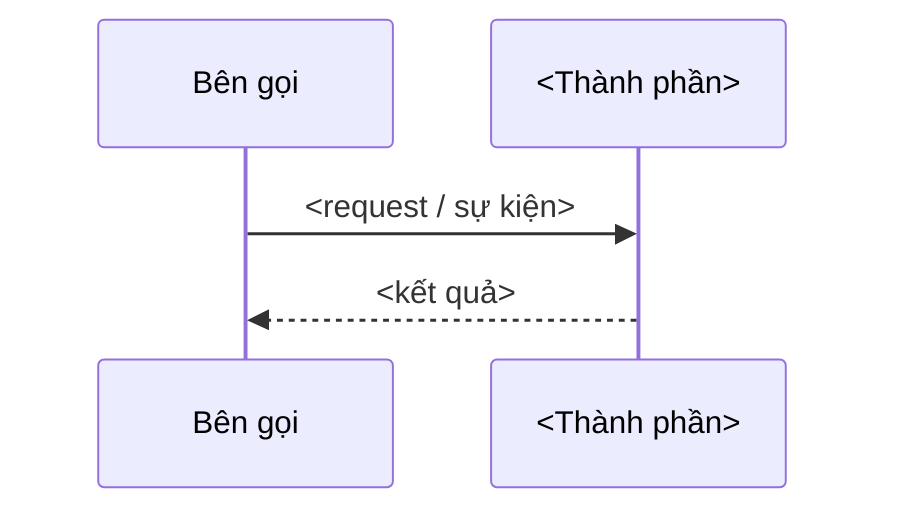

# Giải thích code — <Thành phần>

> Khuôn cho `guides/RE_<Thành_phần>_Code_Walkthrough.md`. Viết khi task có code đã PASS test và lệnh kiểm chứng, trước `code-review` và commit (`CLAUDE.md` gốc §8). Thành phần đã có file giải thích → cập nhật file đó.
> Đọc khi: cần hiểu code của thành phần để sửa tiếp, review, hoặc chuẩn bị vấn đáp.

| | |
|---|---|
| **Chủ sở hữu / Cập nhật** | <hoang.lv> — YYYY-MM-DD |
| **Thành phần** | `services/<service>/` hoặc thư mục cụ thể |
| **Task** | `T<x.y>` (`implementation/PHASE-x.md`) |
| **Thiết kế** | `design/<CỤM>/<MÃ>/` |
| **Commit / PR** | <mã commit hoặc link PR> |

## 1. Luồng chung

<2–5 câu: request hoặc sự kiện đi vào đâu, qua những lớp nào, ra kết quả gì.>



## 2. Cây thư mục

```text
services/<service>/
├─ src/
│  └─ <miền>/
│     ├─ controllers/
│     ├─ services/
│     └─ ...
├─ test/
├─ Dockerfile
└─ package.json
```

## 3. Chức năng từng file

Ghi **mọi** file thuộc thành phần, kể cả cấu hình, migration, test, Dockerfile, compose.

| File | Làm gì | Gọi tới / được gọi bởi | Ghi chú |
|---|---|---|---|
| `src/<miền>/controllers/<tên>.controller.ts` | | | |
| `src/<miền>/services/<tên>.service.ts` | | | |
| `src/database/migrations/<tên>.ts` | | | |
| `test/<tên>.e2e-spec.ts` | | | |
| `Dockerfile` | | | |

## 4. Quyết định không hiển nhiên

| Quyết định | Lý do | Phương án đã loại | Căn cứ |
|---|---|---|---|
| | | | `BR-xx`, ADR, thiết kế §… |

## 5. Câu hỏi vấn đáp

| Câu hỏi | Trả lời ngắn | Xem thêm |
|---|---|---|
| | | |

## 6. Hạn chế đã biết

| Hạn chế | Ảnh hưởng | Hướng xử lý |
|---|---|---|
| | | |
