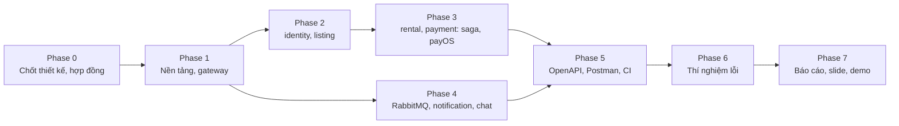

# Kế hoạch triển khai

> Bắt đầu từ đây. File này cho biết làm gì, theo thứ tự nào, ai làm. Nhóm có 3 người (ADR-0001).
> Tiến độ ghi ở `progress.md`. Chi tiết từng task ở `PHASE-x.md`. Vấn đề chờ chốt ở `van-de-can-quyet-dinh.md`.

| | |
|---|---|
| **Chủ sở hữu / Cập nhật** | hoang.lv — 2026-11-12 |

## 1. Lộ trình

| Phase | File | Mục tiêu | A | B | C | Điều kiện xong | Hạn |
|---|---|---|---|---|---|---|---|
| 0 | `PHASE-0.md` | Chốt `[cần xác nhận]` chặn code, hợp đồng nội bộ và sự kiện | ✓ | ✓ | ✓ | `pnpm contracts:check` xanh với hợp đồng v2 | M0 · 2026-11-13 |
| 1 | `PHASE-1.md` | Gateway chạy, identity sau gateway, CI | ✓ | ✓ (CI) | | Tag `v0.1-skeleton` | M0 · 2026-11-13 |
| 2 | `PHASE-2.md` | Identity bổ sung, listing đủ API công khai và nội bộ | ✓ | ✓ | | API nội bộ listing sẵn sàng cho saga | M1 · 2026-11-20 |
| 3 | `PHASE-3.md` | Đặt cọc, hết hạn, hoàn, rút chạy được | | | ✓ | Tag `v0.5-deposit-flow` | M2 · 2026-11-27 |
| 4 | `PHASE-4.md` | Notification, chat, outbox trên mọi service | ✓ | | ✓ (phát sự kiện) | Tắt notification không ảnh hưởng đặt cọc | M3 · 2026-12-04 |
| 5 | `PHASE-5.md` | OpenAPI, Postman, Newman, CI e2e | ✓ | ✓ | ✓ | Newman xanh trên máy sạch | M4 · 2026-12-11 |
| 6 | `PHASE-6.md` | Số liệu E1–E10 | | ✓ | ✓ | Bảng 5.3 báo cáo đã điền | M4 · 2026-12-11 |
| 7 | `PHASE-7.md` | Báo cáo, slide, demo | ✓ | ✓ | ✓ | Tag `v1.0-submission` | M5 · 2026-12-18 |

### Lịch và mốc

Nguồn: kế hoạch sprint `docs/pm/ke-hoach-sprint-va-tai-lieu.xlsx` (đã nhóm xác nhận 2026-11-12). 6 sprint trong 6 tuần, 2026-11-09 → 2026-12-18; mỗi mốc rơi vào thứ Sáu cuối một sprint.

| Mốc | Ngày | Ý nghĩa | Cuối sprint | Phase phải xong |
|---|---|---|---|---|
| M0 | 2026-11-13 | Nền móng | S1 | 0, 1 |
| M1 | 2026-11-20 | Lát cắt đồng bộ | S2 | 2 |
| M2 | 2026-11-27 | Saga chạy — **điểm cắt giảm** | S3 | 3 |
| M3 | 2026-12-04 | Feature freeze | S4 | 4 |
| M4 | 2026-12-11 | Release candidate | S5 | 5, 6 |
| M5 | 2026-12-18 | Bảo vệ | S6 | 7 |

**Năng lực:** 17 giờ/người/tuần × hệ số tập trung 0,75 = 12,75 giờ hiệu dụng/người/tuần. Thời lượng từng task `[cần xác nhận]`, ước theo năng lực này. Task trong xlsx theo luồng reservation cũ; mã WBS ghi ở từng task để đối chiếu.

Phase 2 (B) và Phase 4 (A) chạy song song. C bắt đầu Phase 3 bằng phần không cần listing thật (entity, máy trạng thái, payment) khi hợp đồng Phase 0 đã chốt.

## 2. Phân công

Theo Báo cáo v2 Phụ lục A.

| Vai | Thành viên | Sở hữu | Vấn đáp về |
|---|---|---|---|
| **A** | Lưu Việt Hoàng (B23DCCC073) | Quản lý dự án, `api-gateway`, `identity`, `notification`, `contracts/`, `_template-nest`, `infra/` | Gateway, JWT, outbox/consumer/DLQ, thông báo, quy trình |
| **B** | Đỗ Trung Thành (B23DCCC149) | `listing` (sản phẩm, ảnh S3, PostGIS, giữ chỗ), CI, kiểm thử tải, kịch bản lỗi | Giữ chỗ nguyên tử, tìm kiếm bán kính, số liệu thí nghiệm |
| **C** | Đỗ Trung Thông (B23DCCC153) | `rental`, `payment` (saga, máy trạng thái, công việc nền, payOS, ví) | Saga, bù trừ, webhook, ví, hoàn và rút |

Mọi người trả lời được cơ bản về luồng đặt cọc (`design/RENTAL/RE.DEPOSIT_SAGA/Processing_Flow.md`).

### Ai giao gì cho ai

| Cần | Người giao | Task | Chưa có thì |
|---|---|---|---|
| Hợp đồng nội bộ listing (holds, status) | B | T0.3, T2.3 | C mock theo `example` |
| Hợp đồng nội bộ payment, rental | C | T0.3 | A, B mock |
| Danh mục sự kiện + schema | A (khung), C (sự kiện rental/payment) | T0.4 | Consumer test bằng example |
| Gateway định tuyến | A | T1.2 | Gọi thẳng service, tự gắn `Authorization` |
| `GET /internal/users/:id/bank-account` | A | T2.1 | C mock |
| Binding queue mới | A | T4.1 | Test consumer với hạ tầng thật của template |

## 3. Quy trình cho mỗi task

| # | Bước | Claude dùng |
|---|---|---|
| 1 | Mở task trong `PHASE-x.md`, đọc mục "Đọc trước" | skill `task-state-init` → `.claude/state/<dev-id>/current-task.md` |
| 2 | Tạo nhánh `feature/T<id>-<mô-tả>` từ `develop` | |
| 3 | Đọc thiết kế, quét thứ đã có, lập kế hoạch, **chờ duyệt**; gặp `[cần xác nhận]` chặn task → hỏi người phụ trách | procedure `developer` Bước 1–2, skill `reuse-scan` |
| 4 | Viết test từ "Test bắt buộc" của thiết kế, rồi code (TDD đang bật) | skill `tdd-workflow`, `progress-tracker` |
| 5 | Chạy test và "Kiểm chứng". Thấy pass thật rồi mới tiếp | cổng test của `developer` |
| 6 | Thiết kế sai hoặc thiếu: sửa tài liệu trước, thêm `CHANGELOG.md` | procedure `solution-architect` |
| 7 | Review trước commit, mở PR theo `standards/git-workflow.md §3` | skill `code-review`, procedure `code-reviewer` |
| 8 | Tick vào `progress.md` sau khi merge | |

Dừng giữa chừng: `/cf-handoff` lưu phiên, `/cf-resume` mở lại.

## 4. Definition of Done chung

- [ ] Đủ DoD riêng của task.
- [ ] Test bắt buộc trong thiết kế đều pass (`test`, `test:e2e`, `test:infra` khi chạm hạ tầng).
- [ ] `pnpm lint`, `pnpm format:check`, `pnpm build`, `pnpm contracts:check` không lỗi.
- [ ] Số truy vấn trong ngưỡng `standards/non-functional-standards.md §1`, hoặc đã được duyệt vượt.
- [ ] Không secret, không gọi `axios` trần, không truy cập DB service khác.
- [ ] Biến môi trường mới có trong `.env.example` và `infra/compose/docker-compose.yml`.
- [ ] Hợp đồng `contracts/` khớp code; người phụ trách bên gọi đã duyệt nếu đổi.
- [ ] Một người khác đã duyệt PR, CI xanh.

## 5. Quản lý phụ thuộc giữa người với người

- **Hợp đồng viết trước** trong `contracts/` và `API_Spec.md` (ADR-0012). Hai bên làm song song.
- Bên gọi mock client trong unit test, dùng `test/helpers/http-upstream.ts` của template cho e2e.
- Đổi hợp đồng: bên đổi báo và cùng sửa trong một PR.

## 6. Cắt phạm vi khi thiếu thời gian

Cắt từ trên xuống. Báo cáo §4.7.3 gọi Phase 3 kết thúc là "điểm cắt giảm".

| # | Cắt | Mất |
|---|---|---|
| 1 | Chat (`RE.CHAT`) | Không nhắn tin; thông báo vẫn có |
| 2 | ~~Hồ sơ người thuê~~ | Đã cắt 2026-11-12 (ghi hạn chế) |
| 3 | E6–E9, chỉ giữ E1–E5, E10 | Ít số liệu bổ sung |
| 4 | CI e2e (giữ CI lint/build/test) | Mất kiểm tra tự động trên máy sạch |
| 5 | Rate limit ở gateway | Mất một phần NFR03 |

**Không được cắt:** saga có bù trừ, hết hạn giữ chỗ, timeout + retry, `/health`, OpenAPI, Postman ≥ 10 request, 2 thí nghiệm có số liệu, DLQ.

**Ngoài lộ trình (X1–X5, tương ứng WBS E9-1…E9-5 trong file xlsx; chỉ làm khi đạt M3 feature freeze đúng hạn):** X1 circuit breaker rental → listing, payment → rental; X2 Filebeat → Elasticsearch → Kibana; X3 email thông báo qua Mailpit (email OTP, quên mật khẩu đã vào T2.5); X4 khiếu nại `DISPUTED`; X5 trợ lý chat gợi ý phòng.

## 7. Rủi ro

| Rủi ro | Dấu hiệu | Cách xử lý |
|---|---|---|
| Saga kéo dài | Hết tuần chưa xong nhánh lỗi | Làm thành công trước (T3.2), thêm bù trừ (T3.3), hết hạn (T3.4) |
| C quá tải (rental + payment) | Phase 3 trễ | A nhận payout (`RE.PAYOUT`) sau khi xong Phase 4 `[cần xác nhận]` |
| Webhook không về máy local | Đơn không `PAID` khi demo | Đường hầm ổn định; script giả webhook có chữ ký cho test |
| Nguồn tài liệu lệch nhau | Code theo hợp đồng cũ | `van-de-can-quyet-dinh.md`; Báo cáo v2 là chuẩn |
| Tích hợp vỡ muộn | Ghép lại lỗi | Sau mỗi merge chạy compose + Newman |
| Máy yếu | Container bị kill | Không bật profile `demo` khi phát triển |

## 8. Việc cần chốt ngay

`van-de-can-quyet-dinh.md` mục A (chặn code) và `requirements-traceability.md §5`.
